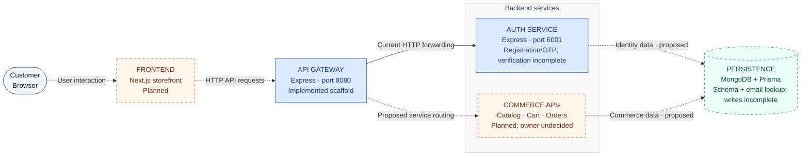
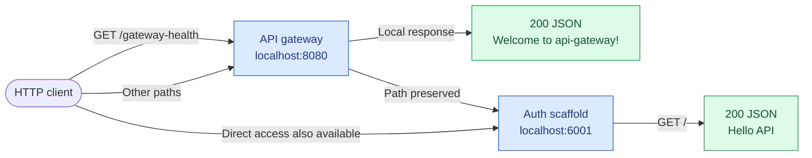

# Architecture

High-level overview of **Microservice Eshop**: the system, technology stack,
project structure, and how requests move between components.

[Documentation index](../README.md) · [Repository](https://github.com/Kruskal892/Microservice-SaaS-E-commerce)

> **Project stage:** Backend foundation. The Express gateway and auth scaffold
> exist alongside initial Prisma/MongoDB schema tooling. The storefront, account
> verification, account creation, and commerce features remain incomplete/planned. Updated **2026-10-20**.

## 01 · System Overview

The intended platform is a Next.js storefront calling Express APIs through a
gateway, with MongoDB/Prisma for persistence. Nx organizes the applications and
their development tasks in one npm workspace.

### Platform at a glance



**Read the diagram:** Blue boxes contain current code. Dashed boxes and arrows
show planned components or connections. Auth now reads users through Prisma; physical databases and service data ownership are still undecided.
Mermaid diagrams display on GitHub and in Mermaid-enabled Markdown previews.

### What runs today



| Component          | Current responsibility                                             | Intended responsibility                                                |
| ------------------ | ------------------------------------------------------------------ | ---------------------------------------------------------------------- |
| Frontend           | No application yet                                                 | Product browsing, account, cart, checkout, order history               |
| API gateway        | Local health, in-memory limiter, configurable auth proxy           | Public API entry point and explicit service routing                    |
| Auth service       | Registration, simple OTP/email flow, Swagger                       | Account registration, login, sessions, identity ownership              |
| Commerce APIs      | Not implemented                                                    | Product, cart, order, and stock behavior; service boundaries undecided |
| Persistent storage | Users/images schema and email lookup; live connectivity unverified | Identity and commerce data using MongoDB/Prisma                        |

Gateway /gateway-health is local and does not check auth. Auth also
serves registration and Swagger routes; unimplemented paths return default 404.

## 02 · Tech Stack

Tools already present in the codebase and the documented direction for future work.
**Configured** means files/tooling exist, not that execution has been verified.

### Foundation

| Layer             | Technology                     | Role                                            | Status                                               |
| ----------------- | ------------------------------ | ----------------------------------------------- | ---------------------------------------------------- |
| Workspace         | Nx + npm workspaces            | App tasks, dependencies, caching                | Configured                                           |
| Language          | TypeScript                     | Strict compiler settings and project references | Configured                                           |
| Backend           | Node.js + Express              | Gateway and auth HTTP servers                   | Scaffold implemented; CI selects Node 24             |
| Gateway           | express-http-proxy             | Forward unmatched requests to auth              | AUTH_SERVICE_URL override; localhost default         |
| HTTP middleware   | cors, express-rate-limit       | Browser policy and IP limits                    | Default IP keys; in-memory counters; no proxy trust  |
| Logging           | Morgan + console               | Request and listener logging                    | Implemented; no centralized monitoring               |
| Build tooling     | esbuild / Webpack              | Auth / gateway compilation                      | Configured                                           |
| Tests             | Jest + SWC + Axios             | Unit tooling and HTTP smoke checks              | Auth root spec exists; gateway E2E mismatched        |
| Formatting / lint | Prettier, EditorConfig, ESLint | Code style and module-boundary rules            | Configured                                           |
| Containers        | Docker                         | Auth-service packaging                          | Dockerfile and targets present; runtime not verified |
| CI                | GitHub Actions                 | Install, lint, test, build, typecheck           | Workflow configured; no deployment job               |

### Platform direction and persistence tooling

| Layer             | Technology        | Intended use                             | Status                                                         |
| ----------------- | ----------------- | ---------------------------------------- | -------------------------------------------------------------- |
| Frontend          | Next.js           | Customer storefront                      | Planned                                                        |
| Database          | MongoDB           | Persistent identity and commerce records | Schema configured; live persistence unverified                 |
| Data access       | Prisma            | Database schema/client                   | Prisma 6.19; auth email lookup wired, user creation incomplete |
| Secondary store   | Redis             | Cache or shared transient state          | Simple OTP strings, cooldowns, and request counters            |
| Events            | Apache Kafka      | Cross-service messaging                  | Planned; no producer/consumer or event contracts               |
| Real-time         | Socket.IO         | Live communication                       | Planned                                                        |
| Push              | Firebase          | Web notifications                        | Planned                                                        |
| Machine learning  | TensorFlow.js     | Future ML features                       | Planned; no defined use case/model                             |
| API documentation | Swagger / OpenAPI | Executable API contract and UI           | Registration spec, /api-docs, and /docs-json                   |
| Assets            | ImageKit          | Cloud media                              | Unconfirmed; inferred from an earlier overview logo            |
| Hosting           | AWS               | Production infrastructure                | Planned; no resources configured                               |
| Domains           | Cloudflare        | Domain management                        | Planned; no configuration                                      |

Authentication libraries, a payment provider, frontend styling/state tools, and
production monitoring have not been selected.

Installed versions: [root package.json](../../package.json) and
[lockfile](../../package-lock.json). Planned direction: [project README](../../README.md#technology-stack).

## 03 · Project Structure

Applications own their code and task configuration. Documentation is grouped by
purpose. Shared error-handler source lives under `packages/`; no frontend exists
yet. Auth imports the shared error handler through the
`@packages/error-handler` alias and bundles its source; the
gateway also uses it.

```text
Microservice Eshop/
|-- apps/
|   |-- api-gateway/             # Public HTTP entry point
|   |   |-- src/main.ts          # Middleware, health route, forwarding
|   |   |-- package.json         # App dependencies and Nx targets
|   |   `-- webpack.config.js    # Gateway build configuration
|   |-- auth-service/            # Identity service scaffold
|   |   |-- src/main.ts          # CORS, root response, listener
|   |   |-- package.json         # esbuild, serve, test, Docker targets
|   |   `-- Dockerfile           # Runs prepared dist output
|   |-- api-gateway-e2e/         # Gateway HTTP test and lifecycle
|   `-- auth-service-e2e/        # Auth HTTP smoke test and lifecycle
|-- docs/
|   |-- product/                # PRD, feature behavior, UI/UX
|   |-- architecture/           # This overview, ERD, technical design
|   |-- api/                    # Current and proposed HTTP contracts
|   |-- delivery/               # Plan, status, deployment
|   |-- development/            # Setup, workflow, tests, troubleshooting
|   `-- README.md               # Documentation index
|-- packages/                   # Workspace library; auth consumes error handling
|   |-- package.json            # Single manifest for all shared modules
|   |-- tsconfig.json           # Shared project references
|   |-- tsconfig.lib.json       # Module inclusion and library output
|   |-- index.ts                # Optional aggregate exports
|   `-- error-handler/          # Error classes and response handler
|-- .github/workflows/ci.yml    # Continuous integration
|-- .vscode/                    # Editor and debug configuration
|-- nx.json                     # Plugins, task defaults, cache inputs
|-- package.json                # Root scripts, dependencies, workspaces
|-- package-lock.json           # Locked dependency tree
|-- tsconfig.base.json          # Shared TypeScript settings
|-- tsconfig.json               # Project references
|-- jest.config.ts              # Test-project discovery
|-- .prettierrc / .prettierignore
`-- README.md                   # Project introduction and quick start
```

**Key entry points:** [gateway main.ts](../../apps/api-gateway/src/main.ts),
[auth main.ts](../../apps/auth-service/src/main.ts), [Nx configuration](../../nx.json).
Auth has routes, a controller, and helpers; gateway middleware remains in main.ts.
See the [auth folder plan](auth-service-structure-plan.md) before reorganizing.

## 04 · Data Flow

### Current HTTP request

1. Gateway applies CORS and logging. The local health route precedes limiting.
2. Other requests pass a 100-request/15-minute in-memory IP limiter, then a proxy
   body limit of 16 KB and ten-second upstream timeout. Proxy trust is disabled.
3. AUTH_SERVICE_URL defaults to http://localhost:6001. Paths are preserved.
4. Auth parses JSON; registration validates/normalizes input and looks up the email.
5. Simple Redis checks/counters precede SMTP delivery and string OTP/cooldown writes.
   Restrictions and delivery failures throw. Account creation is not implemented.
6. Both services use shared error handling and direct app.listen() startup.
   Dependency readiness and graceful shutdown are deferred.

The original ioredis client and sequential OTP operations are retained. Their
concurrency and partial-failure limits are documented in the
[Redis/runtime plan](redis-and-runtime-plan.md). No shared config package or
custom port parser is present. Each service reads PORT with its existing default.

### Proposed customer flow

**Browse → sign in → update cart → review checkout → create order → view history.**

The planned frontend calls public APIs; the owning service validates input,
verifies identity/ownership, and accesses its persistent data. Checkout must
revalidate stock/prices and handle retries without duplicate orders. Responses
update the interface with explicit loading, empty, success, and error states.
Order confirmation must not imply payment success before payment integration.

Contracts and behavior: [API specification](../api/api-specification.md),
[feature specification](../product/feature-specification.md),
[database design](database-design.md), [UI/UX](../product/ui-ux-specification.md).

## 05 · Scalability & Future Considerations

| Area             | Current limit                                                        | Next architectural decision                                              |
| ---------------- | -------------------------------------------------------------------- | ------------------------------------------------------------------------ |
| Service routing  | AUTH_SERVICE_URL override with localhost default                     | Define commerce owners when features exist                               |
| Security         | Default IP keys and no proxy trust; identity incomplete              | Implement verification/sessions and real ingress policy                  |
| Request handling | Limiter before 16 KB proxy body read; shared errors                  | Verify failure/timeout behavior                                          |
| Scaling          | Sequential OTP operations and per-process gateway counters           | Atomic admission before public concurrency; shared counters for replicas |
| Data consistency | Email lookup only; SMTP and Redis writes are separate                | Complete user persistence and delivery-failure policy                    |
| Operations       | Direct listeners; no dependency readiness or graceful shutdown       | Verify runtime; add Redis/SMTP policy when required                      |
| Packaging        | Templates/schema copied; runtime manifests and auth Docker updated   | Verify pruned outputs and image startup                                  |
| Tests            | Auth validation/error/lifecycle checks added; gateway E2E mismatched | Run requested checks and align E2E                                       |
| Product          | No storefront or commerce flow                                       | Implement smallest account/catalog/cart/order slice                      |

AWS and Cloudflare remain planned. PORT defaults to 6001/8080 and HOST is not read.
The auth image uses internal port 3000; set gateway AUTH_SERVICE_URL appropriately
for host-published ports or container network hostnames. Future folder and runtime
changes are plans, not deployed capabilities.

CI uses Node 24, `npm ci`, and `nx run-many -t lint test build typecheck`.
Explicit E2E targets are not included; no successful execution is claimed here.

**Next steps:** Reliable gateway/tests/packaging → identity and persistence →
storefront/catalog/cart/orders → production readiness. Add notifications, events,
and ML when agreed features require them.

For implementation detail, use [technical design](technical-design.md),
[implementation plan](../delivery/implementation-plan.md),
[current status](../delivery/implementation-status.md), and
[deployment guide](../delivery/deployment.md).

Readiness and shutdown are future work in the [HTTP lifecycle plan](http-lifecycle-plan.md);
there is no shared packages/http module or /ready route currently.
