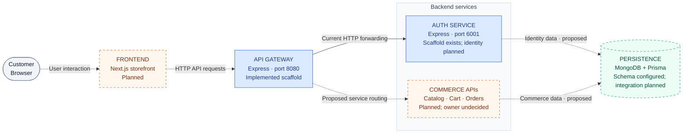

# Architecture

High-level overview of **Microservice Eshop**: the system, technology stack,
project structure, and how requests move between components.

[Documentation index](../README.md) · [Repository](https://github.com/Kruskal892/Microservice-SaaS-E-commerce)

> **Project stage:** Backend foundation. The Express gateway and auth scaffold
> exist alongside initial Prisma/MongoDB schema tooling. The storefront, authentication
> behavior, runtime persistence, and commerce features remain planned. Updated **2026-10-15**.

## 01 · System Overview

The intended platform is a Next.js storefront calling Express APIs through a
gateway, with MongoDB/Prisma for persistence. Nx organizes the applications and
their development tasks in one npm workspace.

### Platform at a glance



**Read the diagram:** Blue boxes contain current code. Dashed boxes and arrows
show planned components or connections. The database has initial schema tooling, while request-path integration remains
planned; physical databases and service data ownership are still undecided.
Mermaid diagrams display on GitHub and in Mermaid-enabled Markdown previews.

### What runs today


| Component          | Current responsibility                                      | Intended responsibility                                                |
| ------------------ | ----------------------------------------------------------- | ---------------------------------------------------------------------- |
| Frontend           | No application yet                                          | Product browsing, account, cart, checkout, order history               |
| API gateway        | Middleware, local health, catch-all proxy to localhost:6001 | Public API entry point and explicit service routing                    |
| Auth service       | CORS and fixed GET / JSON response                          | Account registration, login, sessions, identity ownership              |
| Commerce APIs      | Not implemented                                             | Product, cart, order, and stock behavior; service boundaries undecided |
| Persistent storage | Users/images schema; no service client integration                                     | Identity and commerce data using MongoDB/Prisma                        |

Gateway health is local and does not prove auth is reachable. Auth has no product
routes beyond `GET /`; other forwarded paths normally return its default 404.

## 02 · Tech Stack

Tools already present in the codebase and the documented direction for future work.
**Configured** means files/tooling exist, not that execution has been verified.

### Foundation

| Layer             | Technology                              | Role                                            | Status                                               |
| ----------------- | --------------------------------------- | ----------------------------------------------- | ---------------------------------------------------- |
| Workspace         | Nx + npm workspaces                     | App tasks, dependencies, caching                | Configured                                           |
| Language          | TypeScript                              | Strict compiler settings and project references | Configured                                           |
| Backend           | Node.js + Express                       | Gateway and auth HTTP servers                   | Scaffold implemented; CI selects Node 24             |
| Gateway           | express-http-proxy                      | Forward unmatched requests to auth              | Implemented, fixed upstream                          |
| HTTP middleware   | cors, cookie-parser, express-rate-limit | Browser policy, cookie parsing, IP limits       | Implemented; cookies do not establish identity       |
| Logging           | Morgan + console                        | Request and listener logging                    | Implemented; no centralized monitoring               |
| Build tooling     | esbuild / Webpack                       | Auth / gateway compilation                      | Configured                                           |
| Tests             | Jest + SWC + Axios                      | Unit tooling and HTTP smoke checks              | Auth root spec exists; gateway E2E mismatched        |
| Formatting / lint | Prettier, EditorConfig, ESLint          | Code style and module-boundary rules            | Configured                                           |
| Containers        | Docker                                  | Auth-service packaging                          | Dockerfile and targets present; runtime not verified |
| CI                | GitHub Actions                          | Install, lint, test, build, typecheck           | Workflow configured; no deployment job               |

### Platform direction and persistence tooling

| Layer             | Technology        | Intended use                             | Status                                              |
| ----------------- | ----------------- | ---------------------------------------- | --------------------------------------------------- |
| Frontend          | Next.js           | Customer storefront                      | Planned                                             |
| Database          | MongoDB           | Persistent identity and commerce records | Schema configured; live persistence unverified                                             |
| Data access       | Prisma            | Database schema/client                   | Prisma 6.19 schema and client generation configured; no service consumer                |
| Secondary store   | Redis             | Cache or shared transient state          | Planned; exact use case undecided                   |
| Events            | Apache Kafka      | Cross-service messaging                  | Planned; no producer/consumer or event contracts    |
| Real-time         | Socket.IO         | Live communication                       | Planned                                             |
| Push              | Firebase          | Web notifications                        | Planned                                             |
| Machine learning  | TensorFlow.js     | Future ML features                       | Planned; no defined use case/model                  |
| API documentation | Swagger / OpenAPI | Executable API contract and UI           | swagger-ui-express installed; no spec or route      |
| Assets            | ImageKit          | Cloud media                              | Unconfirmed; inferred from an earlier overview logo |
| Hosting           | AWS               | Production infrastructure                | Planned; no resources configured                    |
| Domains           | Cloudflare        | Domain management                        | Planned; no configuration                           |

Authentication libraries, a payment provider, frontend styling/state tools, and
production monitoring have not been selected.

Installed versions: [root package.json](../../package.json) and
[lockfile](../../package-lock.json). Planned direction: [project README](../../README.md#technology-stack).

## 03 · Project Structure

Applications own their code and task configuration. Documentation is grouped by
purpose. Shared error-handler source lives under `packages/`; no frontend exists
yet. Auth imports the shared error handler through the
`@microservice-eshop/error-handler` alias and bundles its source; the
gateway does not use it.

```text
Microservice Eshop/
|-- apps/
|   |-- api-gateway/             # Public HTTP entry point
|   |   |-- src/main.ts          # Middleware, health route, forwarding
|   |   |-- package.json         # App dependencies and Nx targets
|   |   `-- webpack.config.js    # Gateway build configuration
|   |-- auth-service/            # Identity service scaffold
|   |   |-- src/main.ts          # CORS, root response, listener
|   |   |-- package.json         # esbuild, serve, test, Docker targets
|   |   `-- Dockerfile           # Runs prepared dist output
|   |-- api-gateway-e2e/         # Gateway HTTP test and lifecycle
|   `-- auth-service-e2e/        # Auth HTTP smoke test and lifecycle
|-- docs/
|   |-- product/                # PRD, feature behavior, UI/UX
|   |-- architecture/           # This overview, ERD, technical design
|   |-- api/                    # Current and proposed HTTP contracts
|   |-- delivery/               # Plan, status, deployment
|   |-- development/            # Setup, workflow, tests, troubleshooting
|   `-- README.md               # Documentation index
|-- packages/                   # Workspace library; auth consumes error handling
|   |-- package.json            # Single manifest for all shared modules
|   |-- tsconfig.json           # Shared project references
|   |-- tsconfig.lib.json       # Module inclusion and library output
|   |-- index.ts                # Optional aggregate exports
|   `-- error-handler/          # Error classes and response handler
|-- .github/workflows/ci.yml    # Continuous integration
|-- .vscode/                    # Editor and debug configuration
|-- nx.json                     # Plugins, task defaults, cache inputs
|-- package.json                # Root scripts, dependencies, workspaces
|-- package-lock.json           # Locked dependency tree
|-- tsconfig.base.json          # Shared TypeScript settings
|-- tsconfig.json               # Project references
|-- jest.config.ts              # Test-project discovery
|-- .prettierrc / .prettierignore
`-- README.md                   # Project introduction and quick start
```

**Key entry points:** [gateway main.ts](../../apps/api-gateway/src/main.ts),
[auth main.ts](../../apps/auth-service/src/main.ts), [Nx configuration](../../nx.json).
Handlers currently live in the entry points; controller/service/repository layers
have not been established.

## 04 · Data Flow

### Current HTTP request

1. A client calls the gateway on port **8080**.
2. Middleware applies **CORS → Morgan logging → JSON/URL-encoded parsing → cookie
   parsing → IP rate limiting**. CORS preflight may return before later middleware.
3. A rate-limited request receives **429**. Normal traffic is limited to 100
   requests per 15 minutes; counters are process-local and reset on restart.
4. `GET /gateway-health` returns gateway JSON without contacting auth. Other paths
   are forwarded unchanged to **http://localhost:6001**.
5. Auth applies CORS and returns **200 / Hello API** for `GET /`; the gateway
   passes the upstream response back to the client.

No database writes, sessions, Kafka events, or WebSocket messages participate in
this flow. Direct auth access bypasses gateway middleware. Upstream failures use
the proxy's default handling, not an agreed error envelope.

### Proposed customer flow

**Browse → sign in → update cart → review checkout → create order → view history.**

The planned frontend calls public APIs; the owning service validates input,
verifies identity/ownership, and accesses its persistent data. Checkout must
revalidate stock/prices and handle retries without duplicate orders. Responses
update the interface with explicit loading, empty, success, and error states.
Order confirmation must not imply payment success before payment integration.

Contracts and behavior: [API specification](../api/api-specification.md),
[feature specification](../product/feature-specification.md),
[database design](database-design.md), [UI/UX](../product/ui-ux-specification.md).

## 05 · Scalability & Future Considerations

| Area               | Current limit                                                           | Next architectural decision                                          |
| ------------------ | ----------------------------------------------------------------------- | -------------------------------------------------------------------- |
| Service routing    | All unmatched paths go to fixed localhost:6001                          | Configurable upstreams and clear commerce ownership                  |
| Security           | No identity/token verification; proxy trust and raw-IP keys need review | Session strategy, ownership checks, trusted proxy/IPv6 policy        |
| Request handling   | 100 MB parsers precede limiter; no shared validation/error policy       | Practical body limits, request validation, timeout/error mapping     |
| Scaling            | Rate counters exist only in one process                                 | Shared counters if multiple gateway instances are needed             |
| Data consistency   | No persistence                                                          | Schema/indexes, transaction or stock-reservation policy, idempotency |
| Events and caching | No Kafka/Redis integrations                                             | Adopt for a concrete workflow or measured bottleneck                 |
| Operations         | Console logs; no readiness, alerts, backup or rollback process          | Health/shutdown policy, observability, TLS/secrets, restore/rollback |
| Packaging          | Auth Docker only; app manifests omit imported runtime packages          | Declare dependencies per app and verify pruned outputs/images        |
| Test confidence    | Auth scaffold-only coverage; gateway E2E port/assertion mismatch        | Align lifecycle and cover forwarding, failures, identity, commerce   |
| SaaS / tenancy     | Tenant isolation and billing undefined                                  | Confirm single-store versus multi-tenant scope before data design    |

AWS and Cloudflare are intended technologies, not deployed environments. Local
URLs use HTTP. Both apps read `PORT`, ignore `HOST`, and have no explicit `.env`
loader; changing auth's port does not update gateway forwarding. Auth Docker uses
internal port 3000; publishing `6001:3000` matches a host-run gateway, while separate
containers require a reachable upstream address instead of localhost.

CI uses Node 24, `npm ci`, and `nx run-many -t lint test build typecheck`.
Explicit E2E targets are not included; no successful execution is claimed here.

**Next steps:** Reliable gateway/tests/packaging → identity and persistence →
storefront/catalog/cart/orders → production readiness. Add notifications, events,
and ML when agreed features require them.

For implementation detail, use [technical design](technical-design.md),
[implementation plan](../delivery/implementation-plan.md),
[current status](../delivery/implementation-status.md), and
[deployment guide](../delivery/deployment.md).
