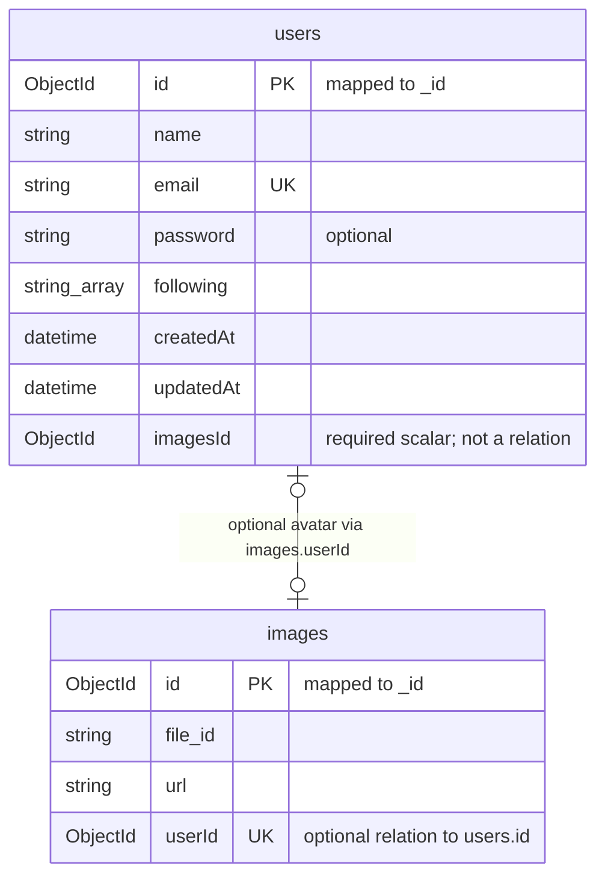

# Current database design

[Documentation hub](../README.md) · [Source schema](../../prisma/schema.prisma)

**Status:** Declared Prisma/MongoDB schema; live synchronization and persistence
are unverified. **Reviewed:** 2026-10-21.

## Current Prisma schema

The datasource uses MongoDB and `DATABASE_URL`. The generator is
`prisma-client-js`, consumed by the shared wrapper through `@prisma/client`.
The schema declares two models, `users` and `images`; catalog, cart, orders,
sessions, and tenancy have no models yet.

Both directions of the avatar association are optional. `images.userId` is the
relation scalar and is unique, allowing at most one related image per user.
`users.avatar` and `images.users` are Prisma relation fields, not extra ObjectId
scalars. `users.imagesId` is required but is **not** connected to this relation.

| Model    | Additional declared behavior                                                                                                           |
| -------- | -------------------------------------------------------------------------------------------------------------------------------------- |
| `users`  | Generated ObjectId; unique email; optional password; string-array following; createdAt defaults to now; updatedAt maintained by Prisma |
| `images` | Generated ObjectId; required file_id and url; optional unique userId                                                                   |

## Current reads and transient state

Registration queries `users.findUnique({ where: { email } })` using a trimmed,
lowercased email. It does not create or update a user. The unrouted verification
placeholder also contains an email lookup, but no completed write path exists.
The schema itself does not enforce email normalization or safe password storage.

OTP values, request counts, and cooldowns live in Redis, outside this schema.
Their key/expiry contract is in [authentication development](../development/authentication.md).
No database transaction spans SMTP and Redis.

## Constraints to resolve before writes

- Decide the purpose of required `users.imagesId` before implementing user creation.
- Treat `following` as plain strings; no declared user relationship enforces it.
- Implement password hashing and service-side validation before storing credentials.
- Verify schema/index application, including unique email and image-user indexes.
  Schema declarations alone do not prove indexes exist in MongoDB.

No migration or seed files are tracked. `prisma.config.ts` names a migrations
directory, but that does not establish a MongoDB migration workflow. Use the
explicit generation and development `db push` steps in
[database setup](../development/getting-started.md#prisma-and-mongodb).
Generation is separate from database connectivity and index synchronization.

The [proposed commerce data model](../future-plans/architecture/commerce-data-model.md)
contains the future catalog/cart/order ERD, consistency policy, and index ideas.
