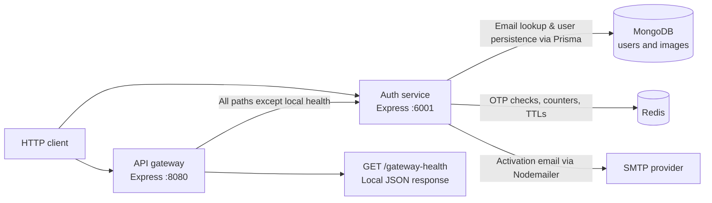

# System architecture

[Documentation hub](../README.md)

**Status:** Current source. **Reviewed:** 2026-10-23. The system is a backend
foundation; integrations shown below are wired in code and remain unverified
against live services.

## System context

An HTTP client can call auth directly or use the gateway. No frontend application
exists. The gateway has one upstream, auth; it does not yet route among multiple
business services or authenticate users.

Arrows describe dependencies in current source, not confirmed connectivity.
Auth root and gateway health responses are local greetings, not readiness probes.
See [request flows](request-flows.md) for execution order and failure paths.

## Boundaries and responsibilities

| Component      | Current responsibility                                                                                                | Source                                                                                                                  |
| -------------- | --------------------------------------------------------------------------------------------------------------------- | ----------------------------------------------------------------------------------------------------------------------- |
| Gateway        | CORS, HTTP logging, local health, IP limits, proxy body limit and timeout                                             | [main.ts](../../apps/api-gateway/src/main.ts)                                                                           |
| Auth           | Registration/verification, email lookup, OTP policy, password hashing/comparison, user persistence, login/JWT cookies | [main.ts](../../apps/auth-service/src/main.ts), [controller](../../apps/auth-service/src/controller/auth.controller.ts) |
| Shared errors  | Error classes and JSON error middleware used by both apps                                                             | [error-handler](../../packages/error-handler/index.ts)                                                                  |
| Shared clients | Prisma client reuse and a simple ioredis instance                                                                     | [Prisma](../../packages/libs/prisma/index.ts), [Redis](../../packages/libs/redis/index.ts)                              |
| MongoDB schema | Identity fields and optional avatar relation                                                                          | [schema.prisma](../../prisma/schema.prisma)                                                                             |
| Nx/npm         | Workspace dependency graph, builds, serve, and checks                                                                 | [nx.json](../../nx.json), [package.json](../../package.json)                                                            |

Shared infrastructure lives in one npm workspace; `@packages/*` names are
TypeScript/build aliases. They are not individual published packages. Auth owns
OTP, registration, verification, and login policy in its app, rather than sharing
those business rules. See [repository structure](repository-structure.md) and
[technical design](technical-design.md).

## Technology in use

| Area                 | Current choice                                                                    |
| -------------------- | --------------------------------------------------------------------------------- |
| Runtime and HTTP     | Node.js, Express 5, TypeScript; CI selects Node 24                                |
| Workspace and builds | Nx/npm, auth esbuild, gateway Webpack                                             |
| Gateway              | express-http-proxy, express-rate-limit, cors, Morgan                              |
| Persistence          | Prisma 6.19 and MongoDB; email lookup & persistence                               |
| Security             | bcryptjs password hashing/comparison; jsonwebtoken signing; HTTP-only JWT cookies |
| Transient data       | ioredis with string OTPs, counters, cooldowns                                     |
| Email                | Nodemailer transport and EJS activation template                                  |
| API discovery        | Committed Swagger 2.0 JSON, swagger-ui-express                                    |
| Validation tooling   | Jest/SWC/Axios, ESLint, Prettier, strict TypeScript                               |
| Delivery tooling     | GitHub Actions checks and an auth-service Dockerfile                              |

The [root manifest](../../package.json) and [lockfile](../../package-lock.json)
own versions. A dependency being installed does not imply an active feature;
for example, cookie-parser is installed but neither entry point mounts it.
Auth login does use jsonwebtoken and Express cookie writing. There is no incoming
cookie parsing, token verification middleware, or protected route consumer yet.

## Runtime constraints

- Gateway health runs before its in-memory 100-request/15-minute IP limiter.
  Other requests are limited before the proxy reads up to 16 KB with a ten-second
  upstream timeout. Proxy trust is disabled.
- Auth parses JSON up to 16 KB. Registration requests OTP delivery via SMTP and
  Redis without creating users. Registration verification (`POST /api/verify-registration`)
  validates the OTP, enforces attempt locks (30-minute lock after 3 failed attempts),
  hashes the password with bcrypt, and persists the user record.
- Login (`POST /api/login`) checks credentials, signs 15-minute access and 7-day
  refresh JWTs, and sets both cookies with a 7-day lifetime. Cookies always use
  Secure, HttpOnly, and SameSite=None. Refresh, logout, revocation, and protected
  requests remain unimplemented; browser deployment policy is unverified.
- OTP checks and counter updates are sequential, so concurrent requests can
  race. SMTP delivery and Redis state are separate operations.
- Three password-recovery routes are mounted with a recovery email template and
  awaited OTP verification, but reset still requires no verification proof.
  See [recovery blockers](../development/authentication.md#password-recovery-blockers).
- Both entry points call `app.listen()` directly. Dependency readiness,
  graceful shutdown, request identity enforcement, and production ingress are absent.
- Docker packaging is an unverified scaffold. Its current single-stage
  Dockerfile uses `node:lts-alpine` and `npm --omit=dev -f install`; it has no
  explicit Prisma generation or non-root user configuration.

Exact contracts and inputs belong to [API](../reference/api.md) and
[configuration](../reference/configuration.md). The current schema has its own
[ERD](database-design.md), and [deployment](../operations/deployment.md) describes
packaging and CI.

## Future direction

Storefront, identity completion, commerce, events, and production infrastructure
are proposals in [future plans](../future-plans/README.md). The
[target platform design](../future-plans/architecture/platform-design.md) has a
separate future-system diagram so those components cannot be mistaken for
available services. The [implementation status](../operations/implementation-status.md)
tracks current gaps.
