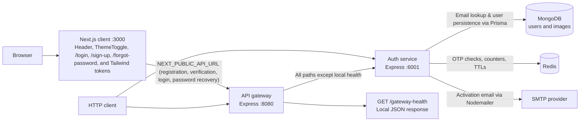

# System architecture

[Documentation hub](../README.md)

**Status:** Current source. **Reviewed:** 2026-11-06. The system is a backend
foundation plus a Next.js/Tailwind client; backend integrations shown below are wired in code and remain unverified
against live services.

## System context

An HTTP client can call auth directly or use the gateway. `apps/client` contains
a Next.js App Router application with shared design tokens, a header with sticky
navigation, search Input, and a `next-themes`-backed light/dark switch, `/login`
and `/sign-up` forms sharing `AuthCard` and the shared password-enabled `Input`, a placeholder `/`
page, and a local hello route. Both forms use Zod/React Hook Form validation.
`/sign-up` connects registration (`POST /api/user-registration`) and OTP
verification (`POST /api/verify-registration`) via Axios and TanStack Query;
`/login` posts credentials with cookies enabled and redirects to `/` on success.
OTP resend reuses registration delivery with a server-enforced cooldown; Google sign-in remains disabled. Client session-aware UI is not implemented.
The gateway has one upstream, auth; it does not yet route among multiple
business services or authenticate users.

Arrows describe dependencies in current source, not confirmed connectivity.
Auth root and gateway health responses are local greetings, not readiness probes.
See [request flows](request-flows.md) for execution order and failure paths.

## Boundaries and responsibilities

| Component      | Current responsibility                                                                                                                                      | Source                                                                                                                  |
| -------------- | ----------------------------------------------------------------------------------------------------------------------------------------------------------- | ----------------------------------------------------------------------------------------------------------------------- |
| Gateway        | CORS, HTTP logging, local health, IP limits, proxy body limit and timeout                                                                                   | [main.ts](../../apps/api-gateway/src/main.ts)                                                                           |
| Client         | Next.js App Router, shared UI/icons/theme, Header, `ThemeToggle`, `/sign-up` registration & OTP verify (`src/api/`), `/login` credential POST, `/api/hello` | [Client README](../../apps/client/README.md), [tokens](../reference/design-tokens.md)                                   |
| Auth           | Registration/verification, email lookup, OTP policy, password hashing/comparison, user persistence, login/JWT cookies, access-token refresh                 | [main.ts](../../apps/auth-service/src/main.ts), [controller](../../apps/auth-service/src/controller/auth.controller.ts) |
| Shared errors  | Error classes and JSON error middleware used by both apps                                                                                                   | [error-handler](../../packages/error-handler/index.ts)                                                                  |
| Shared clients | Prisma client reuse and a simple ioredis instance                                                                                                           | [Prisma](../../packages/libs/prisma/index.ts), [Redis](../../packages/libs/redis/index.ts)                              |
| MongoDB schema | Identity fields and optional avatar relation                                                                                                                | [schema.prisma](../../prisma/schema.prisma)                                                                             |
| Nx/npm         | Workspace dependency graph, builds, serve, and checks                                                                                                       | [nx.json](../../nx.json), [package.json](../../package.json)                                                            |

Shared UI and repo-wide SVG assets live in `packages/ui` and `packages/assets`.
Their contracts and current review limitations are in
[shared UI](../reference/shared-ui.md).

Shared infrastructure lives in one npm workspace; `@packages/*` names are
TypeScript/build aliases. They are not individual published packages. Auth owns
OTP, registration, verification, and login policy in its app, rather than sharing
those business rules. See [repository structure](repository-structure.md) and
[technical design](technical-design.md).

## Technology in use

| Area                 | Current choice                                                                                               |
| -------------------- | ------------------------------------------------------------------------------------------------------------ |
| Runtime and HTTP     | Node.js, Express 5, TypeScript; CI selects Node 24                                                           |
| Workspace and builds | Nx/npm, auth esbuild, gateway Webpack                                                                        |
| Client               | Next.js 16.4, React 19, Tailwind CSS 4.3 via PostCSS, React Hook Form 7.91, Zod 4.6, TanStack Query 5, Axios |
| Gateway              | express-http-proxy, express-rate-limit, cors, Morgan                                                         |
| Persistence          | Prisma 6.19 and MongoDB; email lookup & persistence                                                          |
| Security             | bcryptjs password hashing/comparison; jsonwebtoken signing; HTTP-only JWT cookies                            |
| Transient data       | ioredis with string OTPs, counters, cooldowns                                                                |
| Email                | Nodemailer transport and EJS activation template                                                             |
| API discovery        | Committed Swagger 2.0 JSON, swagger-ui-express                                                               |
| Validation tooling   | Jest/SWC/Axios, ESLint, Prettier, strict TypeScript                                                          |
| Delivery tooling     | GitHub Actions checks and an auth-service Dockerfile                                                         |

The [root manifest](../../package.json) and [lockfile](../../package-lock.json)
own versions. A dependency being installed does not imply every feature is wired;
for example, auth mounts cookie-parser before its routes, while the gateway does not parse cookies, and
client TanStack Query mutations cover registration, OTP verification, and login
(`registrationMutation`, `verifyOtpMutation`, and `loginMutation`). Resend reuses the registration mutation in a separate instance. Auth login uses jsonwebtoken and Express
cookie writing and validates refresh cookies at `POST /api/refresh-token`.
Shared `isAuthenticated` middleware verifies access JWTs, loads the user, and
sets `req.user`; no production route mounts it yet.

Shared authentication middleware is exported from
[`packages/middleware`](../../packages/middleware/index.ts). Missing or rejected
access tokens return 401; database/configuration errors pass to application error
handling. It is available for future routes and does not enforce authorization
roles. See [authentication development](../development/authentication.md#shared-access-token-middleware).

## Runtime constraints

- Gateway health runs before its in-memory 100-request/15-minute IP limiter.
  Other requests are limited before the proxy reads up to 16 KB with a ten-second
  upstream timeout. Proxy trust is disabled.
- Auth parses JSON up to 16 KB. Registration requests OTP delivery via SMTP and
  Redis without creating users. Registration verification (`POST /api/verify-registration`)
  validates the OTP, enforces attempt locks (30-minute lock after 3 failed attempts),
  reuses registration validation/normalization, hashes the password with bcrypt,
  and persists the user record before atomically deleting the matching OTP.
- Login (`POST /api/login`) checks credentials, signs 15-minute access and 7-day
  refresh JWTs, and sets both cookies with a 7-day lifetime. Cookies always use
  Secure, HttpOnly, and SameSite=None. Refresh validates the refresh cookie and
  replaces the access cookie without rotating/extending the refresh JWT. Logout,
  revocation, and protected route consumers remain unimplemented; browser policy
  is unverified.
- OTP cooldown acquisition uses atomic `SET NX` and request counting uses `INCR`.
  The overall sequence and failed-verification updates are separate commands.
  Sending must complete within the 60-second cooldown. SMTP delivery and Redis state are
  separate operations; failed delivery still consumes admission quota.
- Password recovery uses separate OTP keys and atomic verification to issue a
  five-minute single-use reset token. Reset consumes the grant before a conditional
  password update. The frontend connects recovery steps; existing JWT revocation is absent.
  See [password recovery](../development/authentication.md#password-recovery).
- Both entry points call `app.listen()` directly. Dependency readiness,
  graceful shutdown, request identity enforcement, and production ingress are absent.
- Docker packaging is an unverified scaffold. Its current single-stage
  Dockerfile uses `node:lts-alpine` and `npm --omit=dev -f install`; it has no
  explicit Prisma generation or non-root user configuration.

Exact contracts and inputs belong to [API](../reference/api.md) and
[configuration](../reference/configuration.md). The current schema has its own
[ERD](database-design.md), and [deployment](../operations/deployment.md) describes
packaging and CI.

## Future direction

Storefront, identity completion, commerce, events, and production infrastructure
are proposals in [future plans](../future-plans/README.md). The
[target platform design](../future-plans/architecture/platform-design.md) has a
separate future-system diagram so those components cannot be mistaken for
available services. The [implementation status](../operations/implementation-status.md)
tracks current gaps.
