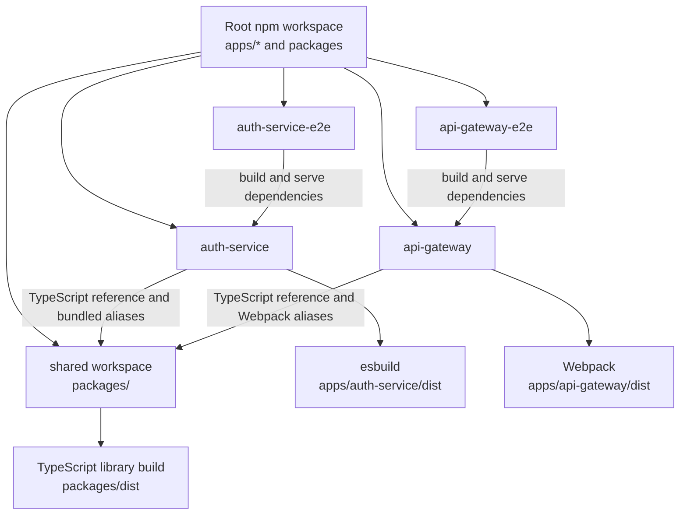

# Repository structure and code ownership

[Documentation hub](../README.md) · [System architecture](overview.md)

**Status:** Current files and configuration. **Reviewed:** 2026-10-23.

## Source layout

```text
.
|-- apps/
|   |-- api-gateway/
|   |   |-- src/main.ts                  # Middleware, local health, proxy, listener
|   |   |-- webpack.config.js            # Build and @packages alias resolution
|   |   `-- package.json                 # App dependencies and Nx targets
|   |-- auth-service/
|   |   |-- src/
|   |   |   |-- main.ts                  # Express wiring, Swagger, listener
|   |   |   |-- routes/auth.router.ts    # Six /api POST routes; recovery Swagger annotations
|   |   |   |-- controller/auth.controller.ts
|   |   |   |-- utils/auth.helper.ts     # Validation, OTP policy, incomplete recovery handlers
|   |   |   |-- utils/cookies/setCookies.ts # Access/refresh cookie policy within auth
|   |   |   |-- mail/
|   |   |   |   |-- mail.client.ts       # EJS rendering and SMTP transport
|   |   |   |   |-- index.ts
|   |   |   |   |-- templates/user-activation-mail.ejs
|   |   |   |   `-- templates/forgot-password-user-email.ejs
|   |   |   |-- swagger.js               # Scans main.ts mounts and annotations; npm run auth-docs
|   |   |   `-- swagger-output.json      # Committed Swagger 2.0 document
|   |   |-- package.json                 # esbuild, serve, prune, Docker targets
|   |   |-- tsconfig.app.json            # App compiler config and shared reference
|   |   |-- jest.config.cts
|   |   `-- Dockerfile
|   |-- api-gateway-e2e/                 # Generated gateway test and port lifecycle
|   `-- auth-service-e2e/                # Auth greeting test and port lifecycle
|-- packages/                           # One shared npm/Nx workspace
|   |-- package.json
|   |-- tsconfig.json
|   |-- tsconfig.lib.json
|   |-- index.ts                        # Aggregate exports; includes client barrels
|   |-- error-handler/
|   |   |-- index.ts                    # Error classes and middleware export
|   |   `-- error-middleware.ts
|   `-- libs/
|       |-- index.ts
|       |-- prisma/index.ts             # Shared Prisma client
|       `-- redis/index.ts              # Shared ioredis client
|-- prisma/schema.prisma
|-- prisma.config.ts                    # CLI schema path, dotenv, DATABASE_URL
|-- docs/                               # See the documentation hub for its tree
|-- .github/workflows/ci.yml
|-- .vscode/                            # Debugger, Prisma, formatter settings
|-- .env.example                        # Placeholder environment configuration
|-- nx.json                             # Inferred targets and task defaults
|-- tsconfig.base.json                  # Strictness, NodeNext, @packages paths
|-- tsconfig.json                       # Root solution references
|-- package.json                        # Root scripts and npm workspaces
`-- package-lock.json
```

Build output, dependencies, Nx state, `.env`, and generated clients are local
artifacts, not application source. The old `generated/prisma` path is ignored;
the current generator produces the client consumed through `@prisma/client`.

## Workspace and build dependencies



These are configured dependencies, not results of a build. The E2E projects have
explicit `e2e` targets; the Nx Jest plugin excludes them from `test` inference.

## Import and ownership rules

`@microservice-eshop/shared` is the shared workspace manifest name.
`@packages/error-handler` and `@packages/libs/prisma` are folder aliases into
that workspace. Shared TypeScript `paths` define compiler resolution; auth
esbuild and gateway Webpack resolve them for their bundles. Plain Node and Jest
need their own resolution if they execute these imports directly.

Import the specific module you need. The aggregate
[packages/index.ts](../../packages/index.ts) re-exports clients that instantiate
Prisma/Redis at import time; importing it can pull infrastructure into a consumer.
The new recovery helper imports Prisma through `@packages/libs`, whose barrel
also re-exports Redis; other client imports in the applications target their
specific modules.

Keep gateway policy in the gateway and identity behavior in auth. Add a shared
folder with an `index.ts` when it has a real consumer; no per-folder manifest or
TypeScript config is required. Detailed consumer setup is in
[adding shared modules](../development/development-guide.md#adding-shared-modules).
The proposed feature-oriented auth layout lives in the
[future structure plan](../future-plans/architecture/auth-service-structure-plan.md).
