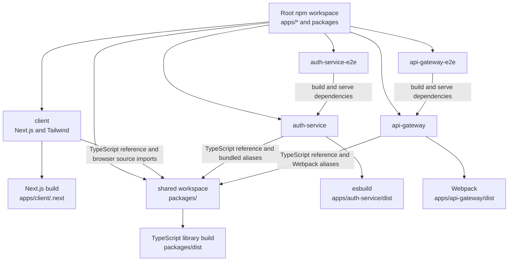

# Repository structure and code ownership

[Documentation hub](../README.md) · [System architecture](overview.md)

**Status:** Current files and configuration. **Reviewed:** 2026-11-05.

## Source layout

```text
.
|-- apps/
|   |-- client/
|   |   |-- src/api/
|   |   |   |-- client.ts               # Shared Axios instance (NEXT_PUBLIC_API_URL, 15s timeout)
|   |   |   |-- auth.ts                 # registrationMutation and verifyOtpMutation options
|   |   |   |-- messages.ts             # Validated server/timeout/fallback message helpers
|   |   |   `-- messages.test.ts        # Permanent standalone Node tests for API message helpers
|   |   |-- src/app/layout.tsx          # Global CSS, Providers, and Header
|   |   |-- src/app/providers.tsx       # QueryClientProvider and next-themes ThemeProvider
|   |   |-- src/app/page.tsx            # Placeholder page
|   |   |-- src/app/global.css          # Tailwind, shared theme import/source, body styles
|   |   |-- src/app/(routes)/login/page.tsx # Login page UI with RHF + Zod validation
|   |   |-- src/app/(routes)/sign-up/page.tsx # Sign-up and OTP verification flow with RHF, Zod, and TanStack Query
|   |   |-- src/app/constants/navigation-menu.ts # Header navigation items
|   |   |-- src/app/api/hello/route.ts   # Local plain-text hello handler
|   |   |-- src/components/index.ts     # Common and layout exports
|   |   |-- src/components/common/      # AuthCard, GoogleButton, ThemeToggle
|   |   |-- src/components/layout/index.ts # Named Header and HeaderBottom
|   |   |-- src/components/layout/Header/
|   |   |   |-- Header.tsx             # Brand/search row and sibling HeaderBottom
|   |   |   |-- HeaderActions.tsx      # Shared account, wishlist/cart links, and theme switch
|   |   |   |-- HeaderBottom.tsx       # CSS-sticky navigation, mobile menu, and compact actions
|   |   |   `-- index.ts               # Default Header and named HeaderBottom
|   |   |-- src/schemas/                # Client Zod validation schemas (login, signUp, otpCode, verifyOtp)
|   |   |   `-- auth.schema.test.ts     # Permanent standalone Node validation tests
|   |   |-- src/utils/zod-resolver.ts   # Zod v4 resolver adapter for react-hook-form
|   |   |-- postcss.config.mjs          # @tailwindcss/postcss
|   |   |-- next.config.js
|   |   |-- tsconfig.json               # Bundler resolution, aliases, shared-source inclusion/reference
|   |   |-- package.json                # @microservice-eshop/client
|   |   `-- README.md
|   |-- api-gateway/
|   |   |-- src/main.ts                  # Middleware, local health, proxy, listener
|   |   |-- webpack.config.js            # Build and @packages alias resolution
|   |   `-- package.json                 # App dependencies and Nx targets
|   |-- auth-service/
|   |   |-- src/
|   |   |   |-- main.ts                  # Express wiring, Swagger, listener
|   |   |   |-- routes/auth.router.ts    # Six /api POST routes; recovery Swagger annotations
|   |   |   |-- controller/auth.controller.ts
|   |   |   |-- utils/auth.helper.ts     # Validation, OTP policy, incomplete recovery handlers
|   |   |   |-- utils/cookies/setCookies.ts # Access/refresh cookie policy within auth
|   |   |   |-- mail/
|   |   |   |   |-- mail.client.ts       # EJS rendering and SMTP transport
|   |   |   |   |-- index.ts
|   |   |   |   |-- templates/user-activation-mail.ejs
|   |   |   |   `-- templates/forgot-password-user-email.ejs
|   |   |   |-- swagger.js               # Scans main.ts mounts and annotations; npm run auth-docs
|   |   |   `-- swagger-output.json      # Committed Swagger 2.0 document
|   |   |-- package.json                 # esbuild, serve, prune, Docker targets
|   |   |-- tsconfig.app.json            # App compiler config and shared reference
|   |   |-- jest.config.cts
|   |   `-- Dockerfile
|   |-- api-gateway-e2e/                 # Generated gateway test and port lifecycle
|   `-- auth-service-e2e/                # Auth greeting test and port lifecycle
|-- packages/                           # One shared npm/Nx workspace
|   |-- package.json
|   |-- tsconfig.json
|   |-- tsconfig.lib.json
|   |-- index.ts                        # Aggregate exports; includes client barrels
|   |-- error-handler/
|   |   |-- index.ts                    # Error classes and middleware export
|   |   `-- error-middleware.ts
|   |-- libs/
|   |   |-- index.ts
|   |   |-- prisma/index.ts             # Shared Prisma client
|   |   `-- redis/index.ts              # Shared ioredis client
|   |-- assets/
|   |   |-- index.ts                    # @packages/assets exports
|   |   |-- svg.d.ts                    # SVG component import declarations
|   |   `-- icons/                     # Repo-wide SVG files and exports
|   `-- ui/
|       |-- index.ts                    # Browser-safe @packages/ui exports
|       |-- icons/                      # Typed registry and React Icon component
|       |-- utils.ts                    # clsx + tailwind-merge helper
|       |-- theme.css                   # Shared tokens and theme selectors
|       |-- README.md                   # Library entry and developer links
|       |-- Overview.stories.tsx         # Storybook getting started
|       |-- Theme.stories.tsx            # Token specimens
|       `-- common/                     # Input, Button, forms, overlays, layout
|           `-- <Component>/            # Implementation, barrel and stories
|-- prisma/schema.prisma
|-- prisma.config.ts                    # CLI schema path, dotenv, DATABASE_URL
|-- docs/                               # See the documentation hub for its tree
|-- .storybook/                        # React/Vite host and shared CSS configuration
|-- .github/workflows/ci.yml
|-- .vscode/                            # Debugger, Prisma, formatter settings
|-- .env.example                        # Placeholder environment configuration
|-- nx.json                             # Inferred targets and task defaults
|-- tsconfig.base.json                  # Strictness, NodeNext, @packages paths
|-- tsconfig.json                       # Root solution references
|-- package.json                        # Root scripts and npm workspaces
`-- package-lock.json
```

Build output, dependencies, Nx state, `.env`, and generated clients are local
artifacts, not application source. The old `generated/prisma` path is ignored;
the current generator produces the client consumed through `@prisma/client`.

## Workspace and build dependencies



These are configured dependencies, not results of a build. The E2E projects have
explicit `e2e` targets; the Nx Jest plugin excludes them from `test` inference.

## Import and ownership rules

The client owns its `@/*` alias into `apps/client/src/*`; its TypeScript config
uses bundler resolution and replaces the root `paths` map. It has no dependency
on shared database clients. Keep Prisma/Redis and their aggregate barrels out of
browser code. Use `@packages/ui` for shared browser components; see
[shared UI](../reference/shared-ui.md) for token imports and Tailwind scanning.
[Client setup](../../apps/client/README.md) and the
[token reference](../reference/design-tokens.md) own frontend conventions.

`@microservice-eshop/shared` is the shared workspace manifest name.
`@packages/error-handler` and `@packages/libs/prisma` are folder aliases into
that workspace. Shared TypeScript `paths` define compiler resolution; auth
esbuild and gateway Webpack resolve them for their bundles. Plain Node and Jest
need their own resolution if they execute these imports directly.

Import the specific module you need. The aggregate
[packages/index.ts](../../packages/index.ts) re-exports clients that instantiate
Prisma/Redis at import time. UI is exposed through its own folder entry.
Importing the aggregate can pull infrastructure into a browser.
Use the specific `@packages/ui`, `@packages/assets/icons`,
`@packages/error-handler`, or `@packages/libs/...` entry instead.
The new recovery helper imports Prisma through `@packages/libs`, whose barrel
also re-exports Redis; other client imports in the applications target their
specific modules.

Keep gateway policy in the gateway and identity behavior in auth. Add a shared
folder with an `index.ts` when it has a real consumer; no per-folder manifest or
TypeScript config is required. Detailed consumer setup is in
[adding shared modules](../development/development-guide.md#adding-shared-modules).
The proposed feature-oriented auth layout lives in the
[future structure plan](../future-plans/architecture/auth-service-structure-plan.md).
