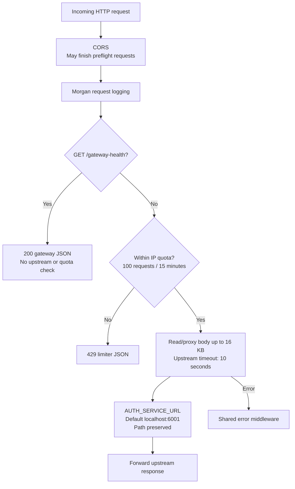
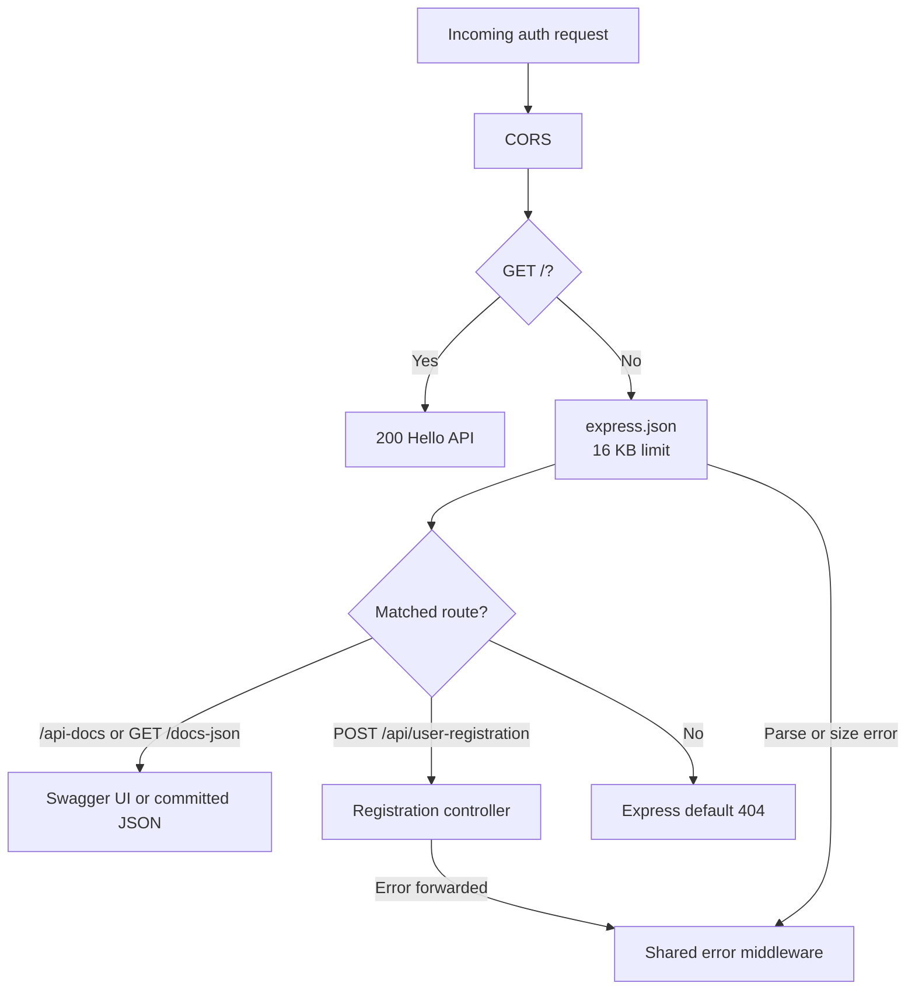
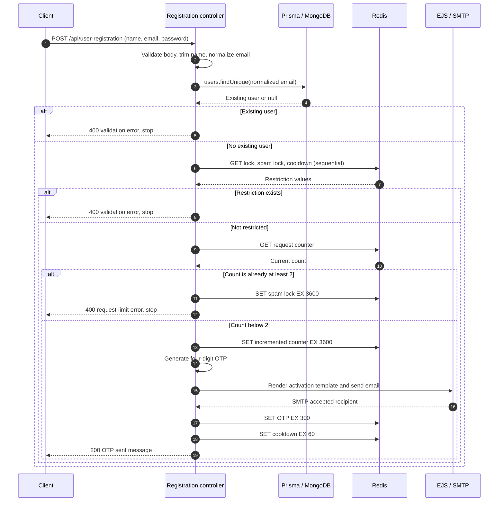
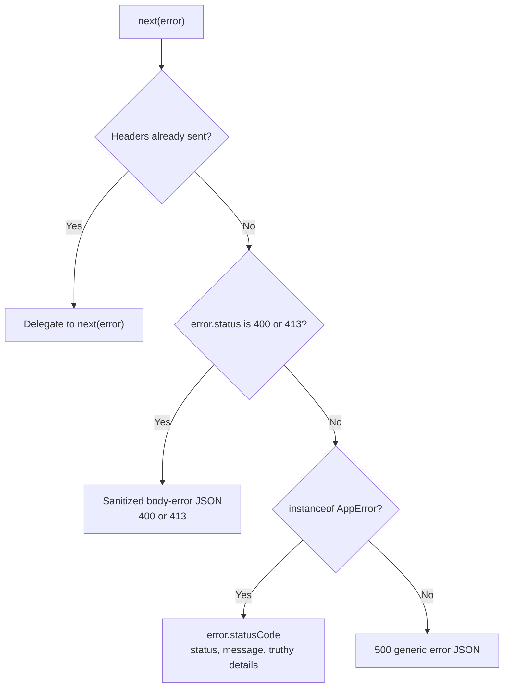

# Request and authentication flows

[Documentation hub](../README.md) · [API reference](../reference/api.md)

**Status:** Current source execution paths. **Reviewed:** 2026-10-21.
These diagrams explain code behavior, not a successful end-to-end run.

## Gateway request lifecycle

Source: [gateway main.ts](../../apps/api-gateway/src/main.ts).

CORS permits the configured browser origin; it does not establish identity.
The limiter is per process and proxy trust is disabled. Gateway error handling
does not implement a dedicated 502/504 policy. Direct auth requests bypass the
gateway quota. See [configuration](../reference/configuration.md).

## Auth request routing

Source: [auth main.ts](../../apps/auth-service/src/main.ts) and
[router](../../apps/auth-service/src/routes/auth.router.ts).

Verification is exported in the controller but is not mounted in the router.
There are no login, session, or commerce routes.

## Registration and OTP delivery

Sources: [controller](../../apps/auth-service/src/controller/auth.controller.ts),
[helpers](../../apps/auth-service/src/utils/auth.helper.ts), and
[mail client](../../apps/auth-service/src/mail/mail.client.ts).

Invalid input stops before the database lookup. Exceptions from Prisma, Redis,
rendering, or SMTP go through the controller's catch to shared error middleware.
SMTP rejection prevents OTP writes, but the request count has already increased.
SMTP can accept the email before a later Redis write fails; SMTP acceptance also
does not guarantee inbox delivery. The sequential checks/updates are not atomic.

This endpoint does not create a user, store a password, verify a code, or issue a
session. See [authentication development](../development/authentication.md) for
key names, TTLs, and implementation gaps.

## Shared error path

Source: [error-middleware.ts](../../packages/error-handler/error-middleware.ts).

The parser-status check precedes `AppError` handling. Unmatched routes use
Express's default 404, and gateway quota rejection has its own envelope.
The [API reference](../reference/api.md#shared-error-handler-auth-service)
owns exact response formats.
