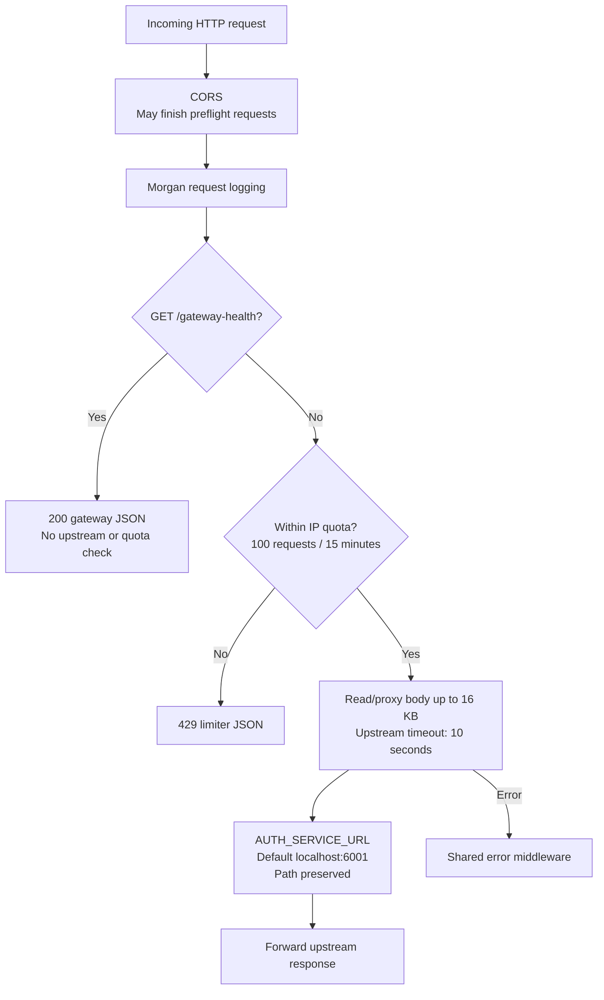
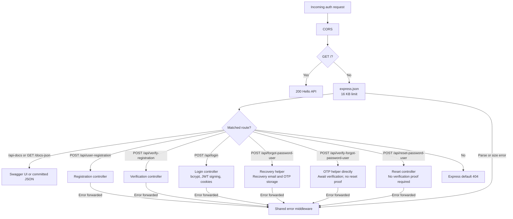
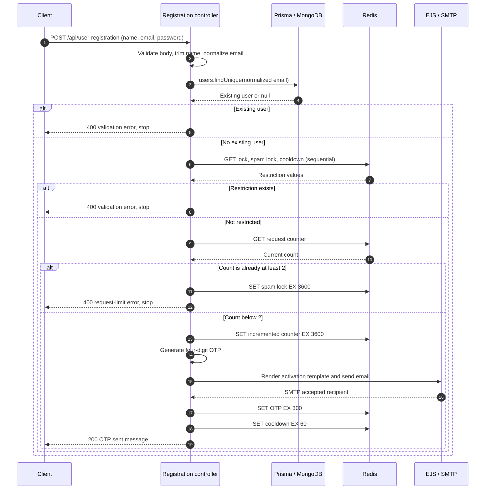
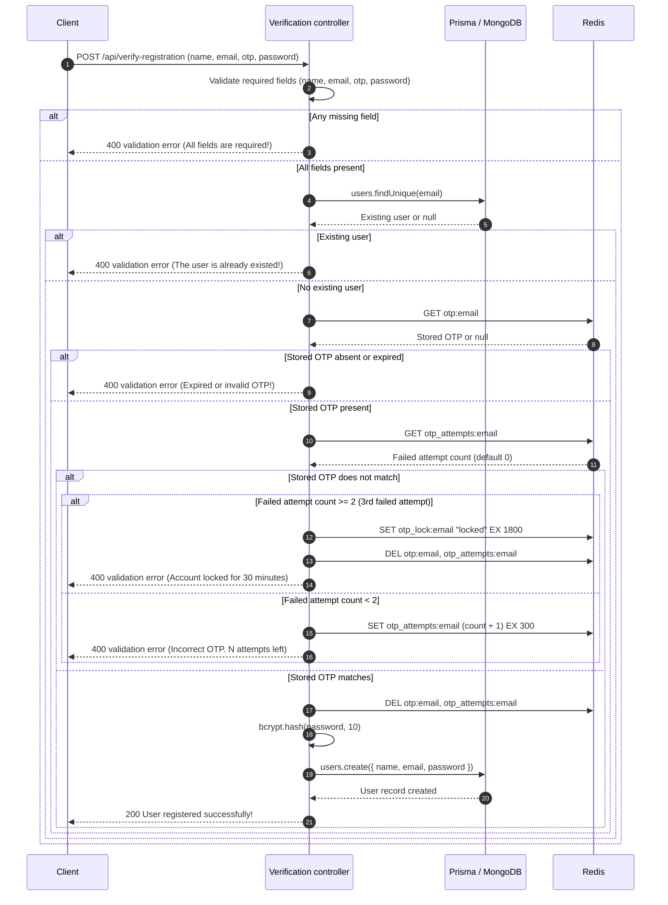
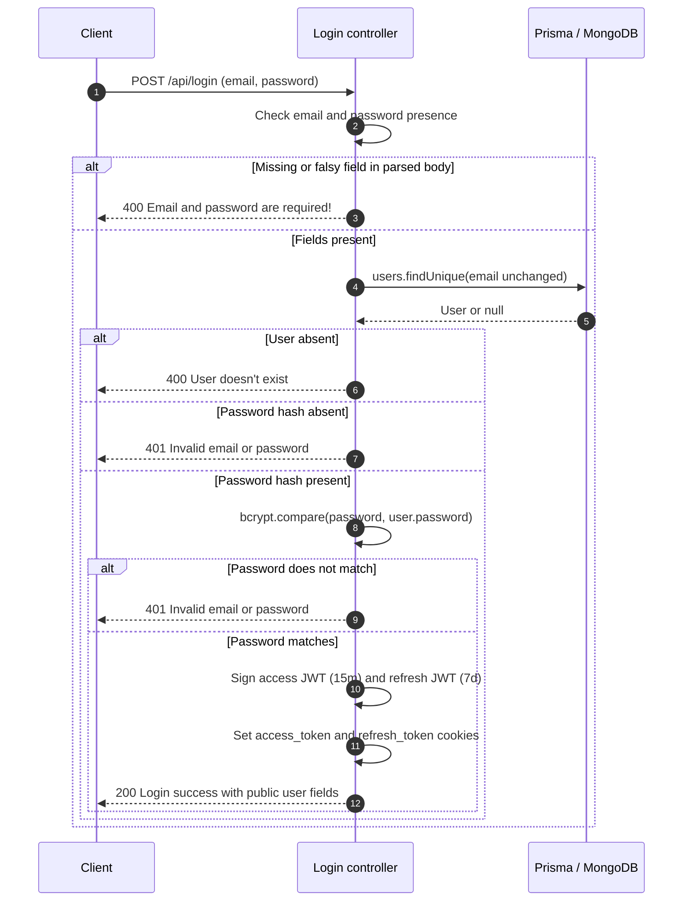
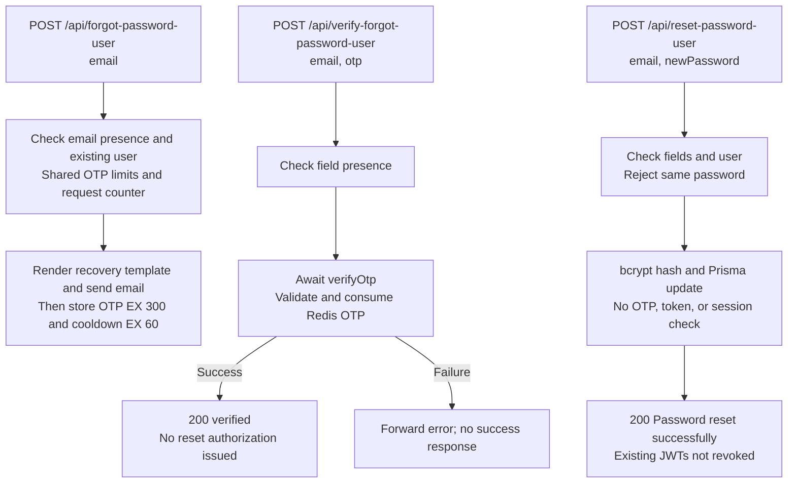
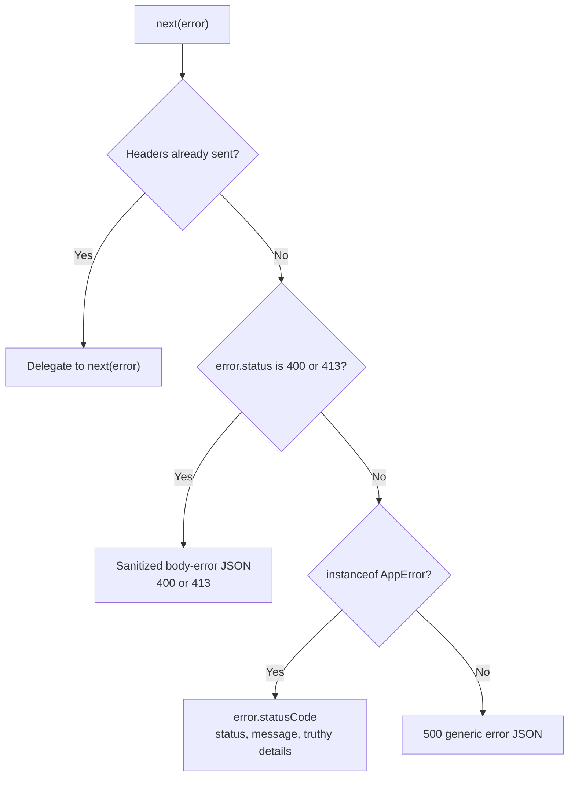

# Request and authentication flows

[Documentation hub](../README.md) · [API reference](../reference/api.md)

**Status:** Current source execution paths. **Reviewed:** 2026-10-25.
These diagrams explain code behavior, not a successful end-to-end run.

These are backend execution paths. The Next.js client currently renders its
header with the shared search input and placeholder page with [Tailwind tokens](../reference/design-tokens.md).
It does not initiate these auth/commerce flows. Its local `/api/hello` text route
is independent of the gateway and is described in the [API reference](../reference/api.md).

## Gateway request lifecycle

Source: [gateway main.ts](../../apps/api-gateway/src/main.ts).

CORS permits the configured browser origin; it does not establish identity.
The limiter is per process and proxy trust is disabled. Gateway error handling
does not implement a dedicated 502/504 policy. Direct auth requests bypass the
gateway quota. See [configuration](../reference/configuration.md).

## Auth request routing

Source: [auth main.ts](../../apps/auth-service/src/main.ts) and
[router](../../apps/auth-service/src/routes/auth.router.ts).

Auth mounts registration, registration verification, login, and three recovery
POST routes. Recovery is incomplete and unsafe. Refresh, logout, current-user, protected, and commerce routes
are not implemented. CORS and issuing cookies do not authenticate later requests.

## Registration and OTP delivery

Sources: [controller](../../apps/auth-service/src/controller/auth.controller.ts),
[helpers](../../apps/auth-service/src/utils/auth.helper.ts), and
[mail client](../../apps/auth-service/src/mail/mail.client.ts).

Invalid input stops before the database lookup. Exceptions from Prisma, Redis,
rendering, or SMTP go through the controller's catch to shared error middleware.
SMTP rejection prevents OTP writes, but the request count has already increased.
SMTP can accept the email before a later Redis write fails; SMTP acceptance also
does not guarantee inbox delivery. The sequential checks/updates are not atomic.

This endpoint does not create a user, store a password, verify a code, or issue a
session. See [authentication development](../development/authentication.md) for
key names, TTLs, and implementation gaps.

## Registration verification and account creation

Sources: [controller](../../apps/auth-service/src/controller/auth.controller.ts),
[helpers](../../apps/auth-service/src/utils/auth.helper.ts), and
[prisma client](../../packages/libs/prisma/index.ts).

Missing fields and existing users are forwarded with `return next(error)`.
For missing/expired/mismatched OTPs, `verifyOtp` calls `next(ValidationError)`
and then throws the return value; it still stops before account creation, but
this Express-dependent error contract needs cleanup. On match,
the OTP is deleted from Redis (single-use consumption), the password is
hashed with `bcryptjs` (10 rounds), and the user record is written to MongoDB.

## Login and JWT issuance

Sources: [controller](../../apps/auth-service/src/controller/auth.controller.ts)
and [cookie helper](../../apps/auth-service/src/utils/cookies/setCookies.ts).

Both JWTs contain user ID and fixed `role: 'user'`; each uses its own environment
signing secret. Both cookies use HttpOnly, Secure, SameSite=None, and a 7-day
cookie lifetime. A retained access cookie does not extend the JWT's 15-minute
expiry. No token verification, refresh, logout, or persistent session store
consumes them yet. Unexpected errors, including absent-body destructuring or
missing signing secrets, are forwarded to shared error handling. See the
[API contract](../reference/api.md#login-and-jwt-cookies) for exact responses.

## Password recovery execution paths

Sources: [router](../../apps/auth-service/src/routes/auth.router.ts),
[controller](../../apps/auth-service/src/controller/auth.controller.ts), and
[helpers](../../apps/auth-service/src/utils/auth.helper.ts).

These are independent public endpoints. The diagram shows current defects;
it does not imply an enforced request → verify → reset sequence.

The recovery template uses the same responsive layout as activation mail and
displays escaped name/OTP values with a five-minute expiry notice. The request
counter increases before sending, so delivery failures still consume quota.
Registration and recovery share the same unscoped OTP state. See the
[API reference](../reference/api.md#password-recovery-incomplete-and-unsafe)
for exact responses and [recovery blockers](../development/authentication.md#password-recovery-blockers)
for required follow-up work.

## Shared error path

Source: [error-middleware.ts](../../packages/error-handler/error-middleware.ts).

The parser-status check precedes `AppError` handling. Unmatched routes use
Express's default 404, and gateway quota rejection has its own envelope.
The [API reference](../reference/api.md#shared-error-handler-auth-service)
owns exact response formats.
