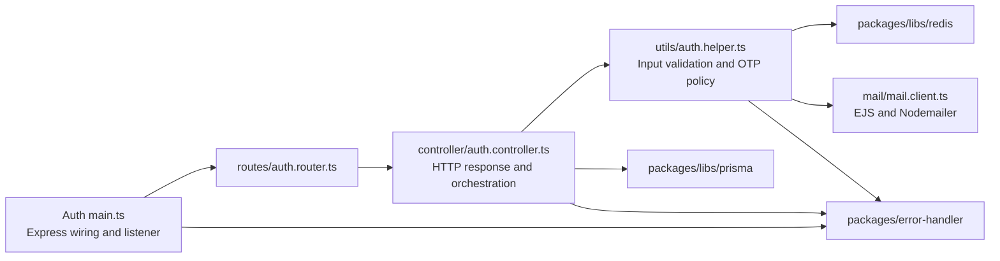

# Current technical design

[Documentation hub](../README.md) · [Architecture overview](overview.md)

**Status:** Current source and configuration. **Reviewed:** 2026-10-21.
Future design decisions live in [future plans](../future-plans/README.md).

## Implementation ownership

The diagram reflects today's mixed helper/controller responsibilities; no
registration service layer exists. The [auth structure plan](../future-plans/architecture/auth-service-structure-plan.md)
proposes a gradual refactor. The gateway keeps its middleware and listener in
its own [main.ts](../../apps/api-gateway/src/main.ts).

## Transport and runtime

Both apps load dotenv at startup, configure CORS for `http://localhost:3000`,
and call `app.listen()` directly with numeric `PORT` or their default. Listener
errors are logged with `console.error` and set `process.exitCode = 1`; there is
no coordinated resource cleanup, so open client handles can still delay exit.
No custom readiness route, shutdown drain, or shared HTTP module exists.

The gateway owns logging, quota enforcement, and upstream proxy configuration.
Auth owns JSON parsing, Swagger, and registration routing. See
[request flows](request-flows.md) for exact ordering and
[configuration](../reference/configuration.md) for inputs/defaults.

## Shared error handler (current source)

Sources: [error classes](../../packages/error-handler/index.ts) and
[middleware](../../packages/error-handler/error-middleware.ts).

`AppError` extends `Error`, capturing a stack and readonly TypeScript fields:
`statusCode`, `isOperational` (default true), and optional `details` (currently
typed `any`). Readonly does not freeze the runtime object. The middleware does
not inspect `isOperational`.

| Class             | HTTP status | Default message                           | Optional details |
| ----------------- | ----------- | ----------------------------------------- | ---------------- |
| `NotFoundError`   | 404         | Resources not found                       | No               |
| `ValidationError` | 400         | Invalid request data                      | Yes              |
| `AuthError`       | 401         | Unauthorized                              | No               |
| `ForbiddenError`  | 403         | Forbidden Access                          | No               |
| `DatabaseError`   | 500         | Database Error                            | Yes              |
| `RateLimitError`  | 429         | Too many requests, please try again later | No               |

Both apps register the four-parameter handler after routes/proxy. It delegates
if headers were sent, sanitizes errors carrying status 400/413, handles
`AppError`, then maps unexpected errors to a generic 500. Application messages
and truthy details are returned unchanged; callers must supply safe public values.
Not every response uses this envelope: gateway limiting and Express default 404s
are separate. Exact payloads belong to the
[API reference](../reference/api.md#shared-error-handler-auth-service).

## Clients and mail

The [Prisma wrapper](../../packages/libs/prisma/index.ts) reuses
`globalThis.prismadb` outside production; production uses the module's client.
Generate `@prisma/client` from the schema before starting auth. The wrapper has
no custom connection readiness or shutdown lifecycle.

The [Redis module](../../packages/libs/redis/index.ts) directly constructs
`new Redis(process.env.REDIS_DATABASE_URL!)`. The TypeScript non-null assertion
does not validate runtime configuration. Sequential GET/SET operations implement
OTP restrictions and counters; there is no atomic admission or gateway Redis store.

The [mail client](../../apps/auth-service/src/mail/mail.client.ts) creates one
Nodemailer transport. It renders EJS from `templates` beside the bundled output,
uses ten-second connection/greeting/socket timeouts, and rejects an SMTP result
with no accepted recipients or any rejected recipients. Registration writes OTP
state after mail acceptance. See [authentication development](../development/authentication.md).

## Build and alias contracts

One `packages/` workspace contains shared source. `@packages/*` resolves through
TypeScript paths, auth's esbuild bundle, and gateway's explicit Webpack alias.
Auth and gateway app compiler configs reference the shared library. Plain Node
does not resolve the alias on its own; auth's Jest config currently has no
`moduleNameMapper` for it.

Auth esbuild emits a CommonJS bundle and copies EJS templates and the Prisma
schema as assets. Gateway Webpack emits to its own dist and enables generated
package metadata. Auth's production build enables lockfile generation; prune
targets prepare runtime packages. The auth Dockerfile is a single-stage scaffold
and does not explicitly generate Prisma files. Actual output and container
startup still require validation; see [deployment](../operations/deployment.md).

[Repository structure](repository-structure.md) and the
[development guide](../development/development-guide.md) explain project references,
task inference, and adding consumers. Future identity, checkout, error-contract,
and consistency decisions belong in the
[platform design](../future-plans/architecture/platform-design.md).
