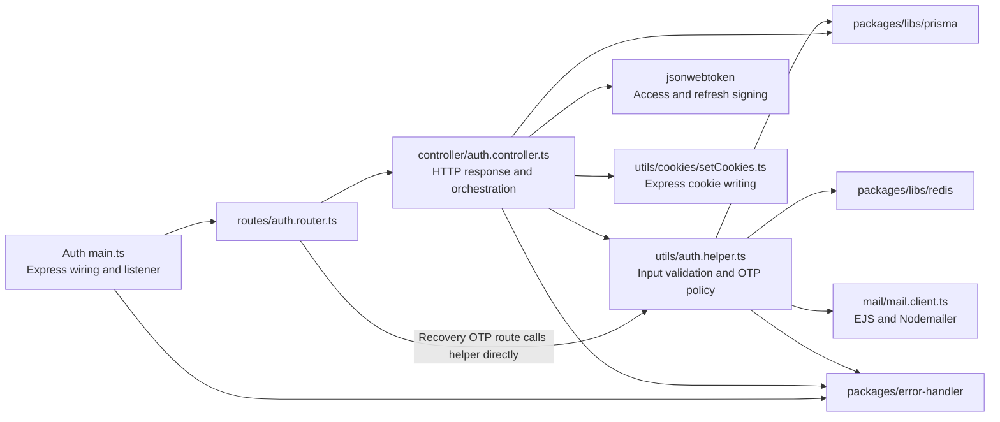

# Current technical design

[Documentation hub](../README.md) · [Architecture overview](overview.md)

**Status:** Current source and configuration. **Reviewed:** 2026-11-06.
Future design decisions live in [future plans](../future-plans/README.md).

## Implementation ownership

The client is a Next.js App Router application, separate from the Express services.
Its root layout imports Tailwind global CSS, wraps the app in `Providers`
(`QueryClientProvider` and `next-themes` `ThemeProvider` to initialize the stored
or OS-preferred theme through `data-theme`), and renders the header (`Header` and
sticky `HeaderBottom`, both containing `ThemeToggle`) before page routes (`/`
placeholder and `/login` and `/sign-up` pages). `/api/hello` is a local Next
route handler. `/login` renders a form card with `GoogleButton`, `@packages/ui`
form controls (`Field`, `Label`, `Input`, `FieldError`, `Checkbox`, `Button`),
and client-side validation via `react-hook-form` and `zod` (`loginSchema` in
`src/schemas/auth.schema.ts` with `zodResolver` in `src/utils/zod-resolver.ts`).
`/sign-up` connects registration (`POST /api/user-registration`) and OTP
verification (`POST /api/verify-registration`) through `src/api/` (`client.ts`,
`auth.ts`). `auth.ts` owns auth mutations and message/retry parsing; the separate
`messages.ts` module was removed. `/login` uses `loginMutation` to post credentials
with `withCredentials: true` and navigates to `/` on success. Resend reuses registration delivery.
Session-aware UI and commerce flows remain unwired.

The shared `packages/ui/theme.css`, imported by client global CSS, owns the
Tailwind CSS-first `@theme` that registers brand/status colors, font, spacing,
type/radius scales, and named breakpoints. `@theme inline` maps semantic colors
to variables selected by light/dark CSS selectors. Base body styles consume the
background, text, and font tokens. `ThemeToggle` (`src/components/common/ThemeToggle`)
uses `useTheme()` for the resolved mode and theme updates. The provider owns
initialization, persistence, cross-tab synchronization, and system-theme
tracking. The theme button is disabled until mounted to avoid hydration mismatches.
System tracking applies while the preference is `system`; the theme button
saves an explicit light/dark preference. `ThemeProvider` lives in `providers.tsx`;
its bootstrap script uses `text/javascript` on the server and `application/json`
in the browser to avoid executing a script during client remounts. Theme effects
remain active. This workaround has not been verified in a browser.
Client CSS explicitly scans `packages/ui`. The header and login page use the shared
native `Input` exported from `@packages/ui`. Its flex wrapper owns field styling and
reacts to native input focus/disabled/invalid state through `:has()` selectors.
`className`, `inputClassName`, `iconContainerClassName`, and `iconClassName` target
the wrapper, input, icon area, and named SVG respectively. Start/end ordering
uses flex order, with no absolute offsets. Raw SVGs are owned by `packages/assets`
and imported through a typed UI registry using the client's SVGR loaders. There
is no search backend. `Header` is the CSS-sticky shell containing desktop navigation and shared
`HeaderActions`. Compact navigation uses the shared Modal, closing on link
selection or Escape with focus restoration. `/wishlist` and `/cart`
links target missing routes; `/forgot-password` connects recovery email, OTP verification,
new-password confirmation, and success with a sign-in link. `/sign-up` connects registration and verification. Empty count
badges are omitted, and cart data remains unwired.
DM Sans is bundled in `packages/assets/fonts/` and loaded by shared CSS. The
root layout sets Eshop metadata. All client text uses the shared family. Shared `Input` adds an accessible eye/eye-off
button automatically for `type="password"`, with flex positioning and scoped
`::-ms-reveal` suppression. Its visibility state lives inside its client boundary.
See [shared UI](../reference/shared-ui.md) and
[design tokens](../reference/design-tokens.md) for the exact contracts.

The diagram below covers backend auth ownership.

`OtpInput` in `packages/ui/common/OtpInput` wraps the `input-otp` primitive with
one themed box per digit, an active-slot highlight, and a caret. The primitive
keeps a single accessible native field underneath the visual boxes for selection,
paste, keyboard editing, form semantics, and autocomplete. The sign-up page
continues to use a controlled code string. Registration posts validated details
to `/api/user-registration` (`registrationMutation`) and opens OTP entry
after a successful response, displaying the validated server message. Failed
requests expose **I received a code**, using the submitted registration snapshot.
Pending
requests disable submission; failures appear on the registration form via
`getApiErrorMessage`. The sign-up page owns Verify email and resend. Successful requests start a
60-second wall-clock countdown with visibility catch-up. Resend uses the submitted
registration snapshot in a separate mutation instance. A successful resend clears
the code; failure preserves it, and server restriction metadata resynchronizes the wait. Its `otpCodeSchema`
accepts exactly four numeric characters, preserving leading zeros, while
`verifyOtpSchema` pairs those digits with the submitted `signUpMutation.variables`
and normalizes `email` to lowercase before `verifyOtpMutation` posts to
`/api/verify-registration`. Verification disables conflicting controls while
pending or succeeded, focuses `OtpInput` on error, and redirects to `/login` on
success. `OtpInput` itself does not
submit, resend, or enforce server rate limits.

The diagram reflects today's mixed helper/controller responsibilities; no
registration service layer exists. The [auth structure plan](../future-plans/architecture/auth-service-structure-plan.md)
proposes a gradual refactor. The gateway keeps its middleware and listener in
its own [main.ts](../../apps/api-gateway/src/main.ts).

## Transport and runtime

Both apps load dotenv at startup, configure CORS for `http://localhost:3000`,
and call `app.listen()` directly with numeric `PORT` or their default. Listener
errors are logged with `console.error` and set `process.exitCode = 1`; there is
no coordinated resource cleanup, so open client handles can still delay exit.
No custom readiness route, shutdown drain, or shared HTTP module exists.

The gateway owns logging, quota enforcement, and upstream proxy configuration.
Auth owns JSON parsing, Swagger, registration/verification, login, and recovery routing. See
[request flows](request-flows.md) for exact ordering and
[configuration](../reference/configuration.md) for inputs/defaults.

## Shared error handler (current source)

Sources: [error classes](../../packages/error-handler/index.ts) and
[middleware](../../packages/error-handler/error-middleware.ts).

`AppError` extends `Error`, capturing a stack and readonly TypeScript fields:
`statusCode`, `isOperational` (default true), and optional `details` (currently
typed `any`). Readonly does not freeze the runtime object. The middleware does
not inspect `isOperational`.

| Class             | HTTP status | Default message                           | Optional details |
| ----------------- | ----------- | ----------------------------------------- | ---------------- |
| `NotFoundError`   | 404         | Resources not found                       | No               |
| `ValidationError` | 400         | Invalid request data                      | Yes              |
| `AuthError`       | 401         | Unauthorized                              | No               |
| `ForbiddenError`  | 403         | Forbidden Access                          | No               |
| `DatabaseError`   | 500         | Database Error                            | Yes              |
| `RateLimitError`  | 429         | Too many requests, please try again later | No               |

Both apps register the four-parameter handler after routes/proxy. It delegates
if headers were sent, sanitizes errors carrying status 400/413, handles
`AppError`, then maps unexpected errors to a generic 500. Application messages
and truthy details are returned unchanged; callers must supply safe public values.
Not every response uses this envelope: gateway limiting and Express default 404s
are separate. Exact payloads belong to the
[API reference](../reference/api.md#shared-error-handler-auth-service).

## Clients and mail

The [Prisma wrapper](../../packages/libs/prisma/index.ts) reuses
`globalThis.prismadb` outside production; production uses the module's client.
Generate `@prisma/client` from the schema before starting auth. The wrapper has
no custom connection readiness or shutdown lifecycle.

The [Redis module](../../packages/libs/redis/index.ts) uses `REDIS_DATABASE_URL`
with five-second connection/command timeouts, one retry per request, and no
offline command queue. Background reconnection remains enabled. Connection
errors log only the error code/name. OTP admission returns 503 while Redis is
not ready instead of queuing a registration request. The TypeScript non-null
assertion does not validate runtime configuration. OTP sending checks locks,
acquires cooldown with native Redis `SET NX`, and counts requests with `INCR`.
It sends email, stores the code, and refreshes cooldown. Sending must finish within
60 seconds; slower/background senders need ownership checks. Verification rejects
a locked email even if resend overlapped the lock. Failed-verification counters remain sequential.
There is no gateway Redis store.

The [mail client](../../apps/auth-service/src/mail/mail.client.ts) creates one
Nodemailer transport. It renders EJS from `templates` beside the bundled output,
uses ten-second connection/greeting/socket timeouts, and rejects an SMTP result
with no accepted recipients or any rejected recipients. Registration writes OTP
state after mail acceptance. See [authentication development](../development/authentication.md).

## Login and API documentation

`loginUser` reads credentials, queries Prisma, compares the bcrypt hash, signs
two JWTs, and returns a public user projection. Tokens carry a fixed user role;
there is no role lookup, session persistence, verification middleware, or refresh
consumer. The access/refresh signing secrets are separate environment inputs.

The cookie helper sets both tokens as HttpOnly/Secure/SameSite=None cookies with
a 7-day lifetime; the access JWT itself expires after 15 minutes. Browser cookie
policy, generic credential errors, input normalization, refresh/rotation, logout,
and request authentication remain follow-ups. Exact behavior is in the
[login contract](../reference/api.md#login-and-jwt-cookies).

Recovery uses Express-aware request/submission helpers; the submission route calls
its helper directly. The unused controller wrapper was removed. Verification is
atomic and mail uses the recovery template. Recovery codes and attempts use
separate keys. Verification issues a five-minute single-use reset grant; reset
consumes it before a conditional bcrypt password update. Existing JWTs are not
revoked. See [password recovery](../development/authentication.md#password-recovery).

`npm run auth-docs` statically scans `main.ts` to retain router prefixes, then
reads controller/router `#swagger` annotations for required fields and example payloads.
Recovery annotations disable automatic inference so helper-based routes retain
explicit request/response schemas and authorization/failure descriptions.
The CommonJS generator exits unsuccessfully on generation failure. Auth loads
the committed JSON at startup; regeneration requires a service restart to update
the served document. Documentation endpoints are excluded from generation.
Swagger host/scheme remain fixed at `http://localhost:6001`.

## Build and alias contracts

One `packages/` workspace contains shared source. `@packages/*` resolves through
TypeScript paths, auth's esbuild bundle, and gateway's explicit Webpack alias.
Auth and gateway app compiler configs reference the shared library. Plain Node
does not resolve the alias on its own; auth's Jest config maps `@packages/*` to
shared source. Controller/helper regressions mock Prisma, Redis, mail, and bcrypt
so those tests do not connect to live services. They have not been run for this update.

Auth esbuild emits a CommonJS bundle and copies EJS templates and the Prisma
schema as assets. Gateway Webpack emits to its own dist and enables generated
package metadata. Auth's production build enables lockfile generation; prune
targets prepare runtime packages. The auth Dockerfile is a single-stage scaffold
and does not explicitly generate Prisma files. Actual output and container
startup still require validation; see [deployment](../operations/deployment.md).

[Repository structure](repository-structure.md) and the
[development guide](../development/development-guide.md) explain project references,
task inference, and adding consumers. Future identity, checkout, error-contract,
and consistency decisions belong in the
[platform design](../future-plans/architecture/platform-design.md).
