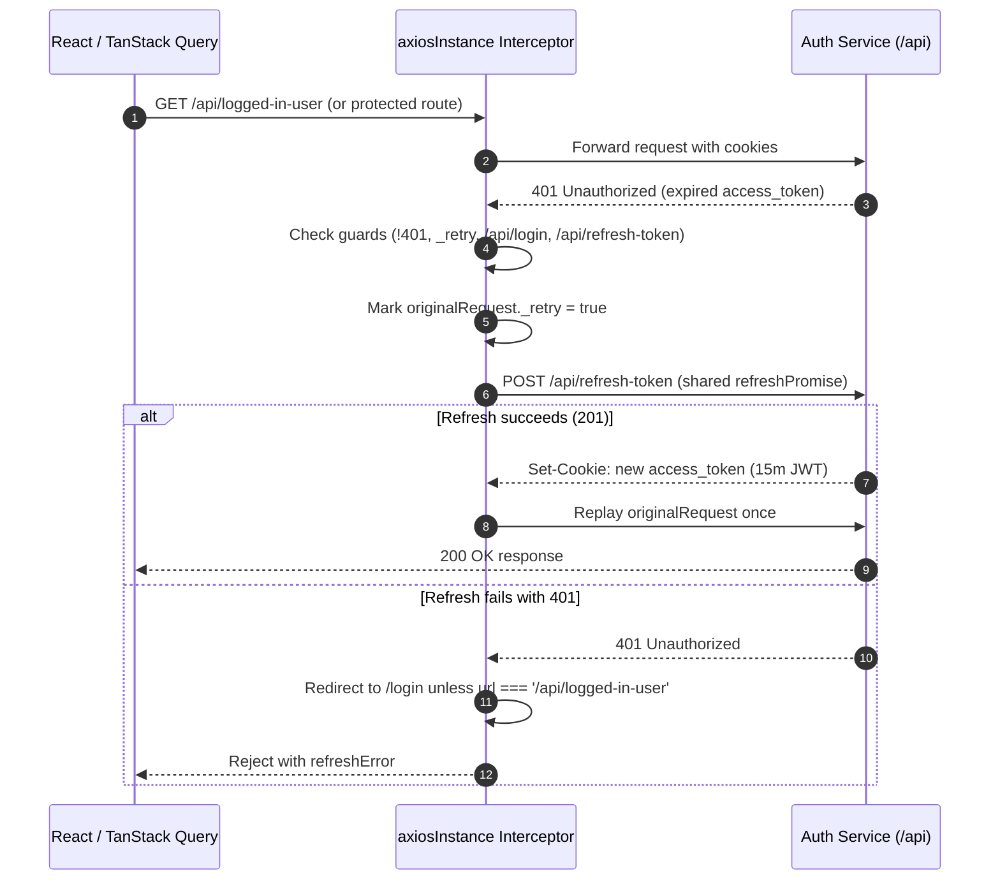

# Session and authentication walkthrough

[Documentation hub](../README.md) · [Authentication development](authentication.md) · [API reference](../reference/api.md)

**Status:** Current source implementation. **Updated:** 2026-11-13.

This walkthrough explains how browser sessions work end-to-end across the Next.js client (`apps/client`), the API gateway (`apps/api-gateway`), and the authentication service (`apps/auth-service`).

## 1. Login and HttpOnly cookie issuance

When a user submits `/login`:

1. `loginMutation` in [`apps/client/src/api/auth.ts`](../../apps/client/src/api/auth.ts) validates `{ email, password }` with `loginSchema` and posts to `POST /api/login` using [`axiosInstance`](../../apps/client/src/utils/axiosInstance.ts) (`withCredentials: true`).
2. `loginUser` in [`auth.controller.ts`](../../apps/auth-service/src/controller/auth.controller.ts) verifies the password hash with `bcrypt.compare` and signs two JWTs containing `{ id: user.id, role: 'user' }`:
   - **`access_token`**: Signed with `JWT_ACCESS_TOKEN_SECRET`, expires in **15 minutes**.
   - **`refresh_token`**: Signed with `JWT_REFRESH_TOKEN_SECRET`, expires in **7 days**.
3. [`setCookies.ts`](../../apps/auth-service/src/utils/cookies/setCookies.ts) writes both tokens as `HttpOnly`, `Secure`, `SameSite=None` cookies with a 7-day cookie `maxAge`.
4. The HTTP 200 response body returns only `{ message, user: { id, email, name } }`. No tokens are exposed to client JavaScript or stored in `localStorage`.

## 2. Authenticated requests (`isAuthenticated`)

Protected routes such as `GET /api/logged-in-user` mount [`isAuthenticated`](../../packages/middleware/isAuthenticated.ts):

1. Reads `req.cookies.access_token` first, falling back to `Authorization: Bearer <token>`.
2. Verifies the JWT signature and expiry against `JWT_ACCESS_TOKEN_SECRET` and requires truthy `id` and `role` claims.
3. Queries MongoDB (`prisma.users.findUnique`) to confirm the user still exists and attaches `req.user`.
4. Returns `401 Unauthorized` if the token is missing, expired, malformed, or belongs to a deleted user.

## 3. Automatic token refresh (`axiosInstance.ts`)

Because `access_token` JWTs expire after 15 minutes while `refresh_token` lasts 7 days, [`axiosInstance.ts`](../../apps/client/src/utils/axiosInstance.ts) registers a response interceptor to refresh expired access tokens transparently:

### Single-flight deduplication (`refreshPromise`)

If multiple protected requests fail with `401` at the same time, `refreshPromise ??= axiosInstance.post('/api/refresh-token', {}).finally(...)` ensures only one refresh request is sent over the network. All concurrent callers await the same promise and replay their respective `originalRequest` once the new `access_token` cookie is set.
