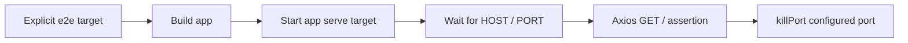

# Testing

[Documentation hub](../README.md)

**Status:** Current test files and target configuration. **Reviewed:** 2026-10-21.

## Existing coverage

| Project      | Present coverage                                              | Limits                                                                   |
| ------------ | ------------------------------------------------------------- | ------------------------------------------------------------------------ |
| Auth service | Jest/SWC configuration, `passWithNoTests: true` target option | No unit-test files; a successful empty run would not prove auth behavior |
| Auth E2E     | Axios `GET /`, expects 200 and `{ message: 'Hello API' }`     | Greeting only; no registration or external-service assertions            |
| Gateway E2E  | Generated Axios `GET /`, expects auth greeting                | Default port 3000 differs from gateway 8080; only gateway is started     |

Source: [auth Jest config](../../apps/auth-service/jest.config.cts),
[auth E2E spec](../../apps/auth-service-e2e/src/auth-service/auth-service.spec.ts),
[gateway E2E spec](../../apps/api-gateway-e2e/src/api-gateway/api-gateway.spec.ts).
No permanent Redis integration, OTP validation, or mail-failure suites are present.

## Focused checks

Run commands from the repository root, choosing checks relevant to the change:

```sh
npx nx test @microservice-eshop/auth-service
npx nx typecheck @microservice-eshop/auth-service
npx nx typecheck @microservice-eshop/api-gateway
npx nx lint @microservice-eshop/auth-service
npx nx lint @microservice-eshop/api-gateway
```

Build commands and compiler ownership are in the [development guide](development-guide.md).
Registration verification (`POST /api/verify-registration`) actively routes to
`userVerification` and invokes `verifyOtp(email, otp, next)`. Run focused typecheck
or test commands to verify changes against compiler and test suites.

## Shared-module and error-handler coverage

Auth Jest transforms TypeScript with SWC but currently has **no**
`moduleNameMapper` for `@packages/*`. When adding tests that import aliased
shared modules, configure matching Jest resolution and isolate clients where
needed. Successful bundler/TypeScript resolution does not establish Jest support.
There are no existing mock-infrastructure suites to rely on.

## E2E lifecycle



Both E2E projects define this lifecycle in their own package/Jest setup.
Auth defaults to `localhost:6001` in readiness and Axios; teardown kills port 6001
unless `PORT` is set. Use a dedicated unused port. An unrelated listener can
satisfy readiness or be terminated by teardown. `HOST` selects the test
destination; it is not an HTTP app bind variable.

Auth's explicit target:

```sh
npx nx e2e @microservice-eshop/auth-service-e2e
```

The gateway's setup/Axios/teardown default to port **3000**, while its app
defaults to **8080**. Its spec checks `/` for the **auth greeting**, and its target
starts only the gateway. Align port, readiness, teardown, and the intended health
contract together before relying on it. A proxy test also needs auth running.
The future correction is tracked in the [implementation plan](../future-plans/implementation-plan.md).

## Coverage still needed

Registration validation, normalized-email duplicates, restriction short-circuiting,
SMTP rejection, Redis failure after acceptance, concurrent OTP admission, expiry,
verification, and user writes need meaningful tests as the behavior is completed.
Packaging also needs checks for template/schema output, pruned dependencies,
generated Prisma runtime files, and container startup. Use dedicated test
MongoDB/Redis/SMTP resources for integration checks.

## CI and verification boundary

[CI](../../.github/workflows/ci.yml) runs `lint test build typecheck` across the
workspace. The Jest plugin excludes both E2E directories from `test` inference;
their explicit `e2e` targets are not in that CI command.

This documentation refresh checked Markdown formatting, local links/anchors,
JSON examples, and rendering of all 23 Mermaid diagrams. Application tests,
lint, builds, live integrations, Docker, and remote CI were not run. See
[implementation status](../operations/implementation-status.md) for current gaps.
