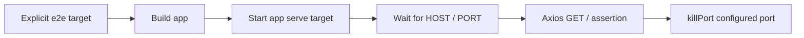

# Testing

[Documentation hub](../README.md)

**Status:** Current test files and target configuration. **Reviewed:** 2026-10-25.

## Existing coverage

| Project      | Present coverage                                              | Limits                                                                   |
| ------------ | ------------------------------------------------------------- | ------------------------------------------------------------------------ |
| Auth service | Jest/SWC configuration, `passWithNoTests: true` target option | No unit-test files; a successful empty run would not prove auth behavior |
| Auth E2E     | Axios `GET /`, expects 200 and `{ message: 'Hello API' }`     | Greeting only; no registration or external-service assertions            |
| Gateway E2E  | Generated Axios `GET /`, expects auth greeting                | Default port 3000 differs from gateway 8080; only gateway is started     |
| Client       | Next.js scaffold and token configuration                      | No client unit, browser, or E2E suite configured                         |

Source: [auth Jest config](../../apps/auth-service/jest.config.cts),
[auth E2E spec](../../apps/auth-service-e2e/src/auth-service/auth-service.spec.ts),
[gateway E2E spec](../../apps/api-gateway-e2e/src/api-gateway/api-gateway.spec.ts).
No permanent Redis integration, OTP validation, login/JWT/cookie, or mail-failure
suites are present.

## Focused checks

Run commands from the repository root, choosing checks relevant to the change:

```sh
npx nx test @microservice-eshop/auth-service
npx nx typecheck @microservice-eshop/auth-service
npx nx typecheck @microservice-eshop/api-gateway
npx nx lint @microservice-eshop/auth-service
npx nx lint @microservice-eshop/api-gateway
```

Build commands and compiler ownership are in the [development guide](development-guide.md).
Registration verification (`POST /api/verify-registration`) actively routes to
`userVerification` and invokes `verifyOtp(email, otp, next)`. Run focused typecheck
or test commands to verify changes against compiler and test suites.

For the shared-library and auth compiler projects directly:

```sh
node node_modules/typescript/bin/tsc -b packages/tsconfig.lib.json apps/auth-service/tsconfig.app.json --pretty false
```

This focused compiler check passed on 2026-10-22. It does not establish Nx build,
runtime packaging, or external-service success.

## Client styling checks

From the repository root:

```sh
node node_modules/typescript/bin/tsc -p apps/client/tsconfig.json --noEmit
npx nx build @microservice-eshop/client
```

The 2026-10-26 no-emit client check stopped at `TS6305` because referenced
shared-library declarations were missing. No shared-library build was run.
The standalone command requires those outputs first; its failure is not a
successful check of the input implementation.

A client typecheck does not compile Tailwind CSS. Validate token changes through
the Tailwind/PostCSS pipeline or the Next build as well. Check generated utilities
against the [token reference](../reference/design-tokens.md): brand/status colors,
semantic colors, type/radius scales, spacing, named breakpoints, and the custom
`dark:` selector. Keep checks temporary for a token-only change; no shopping
behavior or accessibility conformance can be inferred from generated CSS.

For future browser checks, run the client and verify both `.dark` and
`data-theme="dark"`, light reset, keyboard focus for real components, and widths
below/at 390px, 768px, and 1440px. The header contains the shared search input and the page remains a placeholder.
For the input, check light/dark colors, keyboard focus, disabled and
`aria-invalid` states, label/error associations, native props and React 19 refs,
controlled/uncontrolled values, file selection, and `className` overrides. Repeat
the CSS import/source setup in another app before claiming cross-app verification.
These checks are instructions; no input build, lint, tests, or browser checks
were run for the 2026-10-26 change.

There is currently no shared UI rendering spec or configured shared UI Jest
runner. Do not infer automated coverage from the source implementation. Future
coverage should exercise named/default and custom SVG sizing, start/end flex
ordering, independent wrapper/input/icon-container styling, native attributes,
and fields without icons. SVG imports need mocks or an SVG transformer.

For manual browser checks, compare default named icons with `iconClassName="size-8"`,
check start/end alignment in LTR and RTL, and verify the header's light/dark
surface contrast. Also check wider icon containers, focus, disabled/invalid
states, custom input heights, and accessible field names. These steps have not
been executed for this change.

The gateway E2E port-3000 mismatch is especially relevant now that the client
also defaults to 3000; do not mistake a frontend response for gateway health.

## Swagger and authentication checks

Run `npm run auth-docs` and inspect the generated paths:

- `POST /api/user-registration`: required name, email, password.
- `POST /api/verify-registration`: required name, email, string OTP, password.
- `POST /api/login`: required email and password.
- `POST /api/forgot-password-user`: required email; recovery template and five-minute OTP.
- `POST /api/verify-forgot-password-user`: required email and string OTP; document
  that verification is awaited but no reset proof is issued.
- `POST /api/reset-password-user`: required email and newPassword; document the
  missing verification gate and existing-token invalidation.
- Each auth POST has concrete request-property examples and a 200 response schema.
- Recovery routes include 400/500 responses and their current limitations.
- `GET /` has a greeting example; `/api-docs` and `/docs-json` are excluded.

Generation should produce identical JSON from the root npm script and from
`node swagger.js` in `apps/auth-service/src`. Restart auth to load a regenerated
document. These are static documentation checks, not endpoint tests.

For live login verification, use a dedicated test user created through OTP
verification, configured MongoDB/Redis/SMTP, and both JWT signing secrets. Check
missing credentials (400), unknown email (400), wrong password (401), and success
(200 with only public user fields). Inspect both `Set-Cookie` headers without
logging token values. Verify 15-minute access/7-day refresh JWT expiry and the
shared 7-day cookie retention, then exercise browser credentials and Secure-cookie
behavior in the intended HTTPS setup. Such integration checks have not been run
for this change. Refresh/logout/protected routes do not exist to test yet.

Recovery has no permanent behavior coverage. Before treating it as usable, fix
the [known blockers](authentication.md#password-recovery-blockers), then verify
delivery recipient/template, invalid/expired OTP rejection before any success
response, and short-lived single-use reset authorization bound to the correct
user and recovery purpose. Verify direct reset without proof fails without
changing a password, reused/expired proof fails, replacement-password validation
matches policy, and existing-token behavior is intentional. Use disposable
accounts; the current reset handler can change any known user's password.
These are required follow-up checks, not passing results from this refresh.

## Shared-module and error-handler coverage

Auth Jest transforms TypeScript with SWC but currently has **no**
`moduleNameMapper` for `@packages/*`. When adding tests that import aliased
shared modules, configure matching Jest resolution and isolate clients where
needed. Successful bundler/TypeScript resolution does not establish Jest support.
There are no existing mock-infrastructure suites to rely on.

## E2E lifecycle



Both E2E projects define this lifecycle in their own package/Jest setup.
Auth defaults to `localhost:6001` in readiness and Axios; teardown kills port 6001
unless `PORT` is set. Use a dedicated unused port. An unrelated listener can
satisfy readiness or be terminated by teardown. `HOST` selects the test
destination; it is not an HTTP app bind variable.

Auth's explicit target:

```sh
npx nx e2e @microservice-eshop/auth-service-e2e
```

The gateway's setup/Axios/teardown default to port **3000**, while its app
defaults to **8080**. Its spec checks `/` for the **auth greeting**, and its target
starts only the gateway. Align port, readiness, teardown, and the intended health
contract together before relying on it. A proxy test also needs auth running.
The future correction is tracked in the [implementation plan](../future-plans/implementation-plan.md).

## Coverage still needed

Registration validation, normalized-email duplicates, restriction short-circuiting,
SMTP rejection, Redis failure after acceptance, concurrent OTP admission, expiry,
verification, and user writes need meaningful tests as the behavior is completed.
Login needs coverage for exact-email lookup, input types and missing bodies,
password comparison, signing-secret failure, token claims/expiry, public response
projection, and cookie attributes. Add request identity, refresh/rotation,
revocation/logout, and browser/CSRF checks when those features are implemented.
Packaging also needs checks for template/schema output, pruned dependencies,
generated Prisma runtime files, and container startup. Use dedicated test
MongoDB/Redis/SMTP resources for integration checks.

## CI and verification boundary

[CI](../../.github/workflows/ci.yml) runs `lint test build typecheck` across the
workspace. The Jest plugin excludes both E2E directories from `test` inference;
their explicit `e2e` targets are not in that CI command.

The 2026-10-25 token refresh passed client TypeScript and a direct production
Next build, 48 generated Tailwind utilities, computed light/dark CSS values,
documentation formatting/navigation/JSON checks, and rendering of all 26 diagrams.
Exact commands, counts, the local Node version, and unrun checks are recorded in
[implementation status](../operations/implementation-status.md#documentation-verification-boundary).
No client behavior suite or backend/live-service check was run.

The earlier login/Swagger refresh records source and documentation checks in the
[implementation status](../operations/implementation-status.md#documentation-verification-boundary).
Application unit/E2E tests, lint, Nx builds, live integrations, Docker, and remote
CI were not run during those earlier refreshes. Documentation generation and compiler checks do not prove those
results. The 2026-10-23 recovery refresh runs documentation generation/formatting
and static diff inspection only; the historical compiler check was not rerun. See
[implementation status](../operations/implementation-status.md) for current gaps.
