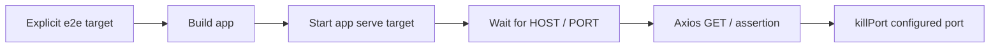

# Testing

[Documentation hub](../README.md)

**Status:** Current test files and target configuration. **Reviewed:** 2026-11-10
for refresh/middleware; older dated records retain their original scope.

## Existing coverage

| Project      | Present coverage                                                           | Limits                                                                     |
| ------------ | -------------------------------------------------------------------------- | -------------------------------------------------------------------------- |
| Auth service | Jest/SWC controller/helper/middleware regressions with mocked dependencies | 93 tests passed on 2026-11-10; no live Redis, database, or SMTP assertions |
| Auth E2E     | Axios `GET /`, expects 200 and `{ message: 'Hello API' }`                  | Greeting only; no registration or external-service assertions              |
| Gateway E2E  | Generated Axios `GET /`, expects auth greeting                             | Default port 3000 differs from gateway 8080; only gateway is started       |
| Client       | Standalone Node schema tests and Jest auth message/retry tests             | Auth Jest suite configured but unrun; no browser or E2E suite              |

Source: [auth Jest config](../../apps/auth-service/jest.config.cts),
[auth controller/helper regressions](../../apps/auth-service/src/controller/auth.controller.spec.ts),
[auth E2E spec](../../apps/auth-service-e2e/src/auth-service/auth-service.spec.ts),
[gateway E2E spec](../../apps/api-gateway-e2e/src/api-gateway/api-gateway.spec.ts),
[client schema test](../../apps/client/src/schemas/auth.schema.test.ts),
[client auth tests](../../apps/client/src/api/auth.test.ts).
Refresh JWT/cookie and shared access-token middleware regressions are present.
No permanent live Redis integration, login-controller, or live mail-failure
suites are present.

## Focused checks

The schema test uses Node's built-in runner and type stripping. Auth message/retry
tests moved from `messages.test.ts` into `auth.test.ts` alongside `auth.ts`.
They use the installed Jest/SWC tools and a small client config to resolve `@/`
imports. No dependency was added. Run explicitly from the root:

```sh
node --experimental-strip-types --test apps/client/src/schemas/auth.schema.test.ts
node node_modules/jest/bin/jest.js --config apps/client/jest.config.cts --runInBand
```

The standalone schema test is not wired into Jest; the client Jest config is
available to Nx's existing Jest plugin. Target execution has not been checked.
The schema test covers registration
field limits, password confirmation, four-digit OTP codes (including leading
zeros and rejection of short, long, non-numeric, and whitespace-padded codes),
and `verifyOtpSchema` payload validation with lowercase email normalization. The
API message test covers validated server message extraction, safe fallbacks for
non-string/blank payloads, and `ECONNABORTED`/`ETIMEDOUT` timeout guidance.

For the sign-up OTP controls, manually check that incomplete codes cannot submit,
four digits submit `POST /api/verify-registration` with the normalized email from
the registration variables, conflicting controls are disabled while verification
is pending or succeeded, server/timeout errors focus the OTP input and display an
alert, and a successful response redirects to `/login`. After a failed signup
request, **I received a code** must open OTP entry for the submitted email even
if the form was subsequently edited. After successful delivery, resend counts down
from 60 seconds, catches up after a background tab, and calls `/api/user-registration`
with the submitted snapshot. Check that resend/verify/change-email actions cannot
conflict, success clears the entered code, failure preserves it, and server
restriction metadata resets the displayed remaining wait. Check timer cleanup on
navigation, error/status announcements, and the initial-plus-one-resend quota.
These browser checks have not been run.

Auth regression tests in `auth.controller.spec.ts` cover server validation,
normalized details, OTP preservation after hashing/database failures, error
forwarding, expiry/lockout, concurrent duplicate creation, cleanup failure after
persistence, recovery authorization, and password reset. The controller and
password-reset suites passed 73 tests on 2026-11-08 using mocked Redis/database/mail
dependencies; they do not prove live Lua, database, or SMTP behavior.
Additional resend regressions cover normalized delivery, restriction waits,
`SET NX` rejection, quota rejection, SMTP failure, OTP storage failure, and an
active verification lock despite a matching code from an overlapping resend.
Client message tests cover valid and malformed retry metadata. These tests are
authored separately; mocked Redis results do not prove the Lua scripts in Redis.

Run commands from the repository root, choosing checks relevant to the change:

```sh
npx nx test @microservice-eshop/auth-service
npx nx typecheck @microservice-eshop/auth-service
npx nx typecheck @microservice-eshop/api-gateway
npx nx lint @microservice-eshop/auth-service
npx nx lint @microservice-eshop/api-gateway
```

Build commands and compiler ownership are in the [development guide](development-guide.md).
Registration verification (`POST /api/verify-registration`) actively routes to
`userVerification` and invokes `verifyOtp(email, otp)`. Run focused typecheck
or test commands to verify changes against compiler and test suites.

For the shared-library and auth compiler projects directly:

```sh
node node_modules/typescript/bin/tsc -b packages/tsconfig.lib.json apps/auth-service/tsconfig.app.json --pretty false
```

This focused compiler check passed on 2026-10-22. It does not establish Nx build,
runtime packaging, or external-service success.

## Client styling checks

From the repository root:

```sh
node node_modules/typescript/bin/tsc -p apps/client/tsconfig.json --noEmit
npx nx build @microservice-eshop/client
```

The 2026-10-26 no-emit client check stopped at `TS6305` because referenced
shared-library declarations were missing. No shared-library build was run.
The standalone command requires those outputs first; its failure is not a
successful check of the input implementation.

A client typecheck does not compile Tailwind CSS. Validate token changes through
the Tailwind/PostCSS pipeline or the Next build as well. Check generated utilities
against the [token reference](../reference/design-tokens.md): brand/status colors,
semantic colors, type/radius scales, spacing, named breakpoints, and the custom
`dark:` selector. Keep checks temporary for a token-only change; no shopping
behavior or accessibility conformance can be inferred from generated CSS.

The following browser checks are suggested, not completed for this change:

1. Check `ThemeToggle` in the sticky header. Verify reload
   persistence, same-origin cross-tab synchronization, and live OS updates while
   the preference is `system`. Selecting the theme button saves an explicit
   mode; restore `system` through `setTheme('system')` when checking OS tracking.
2. Check keyboard operation, announced pressed state, and hydration warnings on
   reload in both themes and after client navigation/remounts. The provider lives
   in `src/app/providers.tsx`; its bootstrap is executable in server HTML and inert
   on client render. Confirm the script-tag warning is absent without losing
   initial theme selection. This workaround has not been browser-verified.
   The theme button remains disabled until mounted.
3. Open `/login` and `/sign-up`. Check required fields, invalid email, password
   length, mismatched confirmation, and error-to-field associations. Login posts
   `{ email, password }` to `/api/login` with credentials enabled; check server
   errors and redirect to `/` on success. Remember-me is not submitted. Check
   the mutation remains pending through the current-user cache invalidation,
   and that the header changes to a profile link. Signup posts validated
   details to `/api/user-registration`; verify the button remains busy during
   a slow request and failures are visible on the registration form. A successful
   response opens OTP entry automatically; **I received a code** also opens it
   after a failed request using submitted details. In OTP entry, verify that submitting a
   four-digit code posts to `/api/verify-registration`, disables OTP controls
   while pending, shows server/timeout errors, and redirects to `/login` on
   success. Neither form should log credentials.
   At 320px, check that the header fits and sign-in is available in the menu.
4. Check password eye/eye-off controls by pointer and keyboard. In Edge, typing
   should show only the custom reveal button. Inspect password-manager overlays
   and confirm that toggling visibility never submits the form.
   Shared `Input` should preserve native refs, controlled/uncontrolled values,
   and existing start/end icons alongside the built-in reveal button. Non-password
   types should retain their existing rendering.
   With browser-saved credentials, verify that autofilled email/password fields
   and the eye area share the themed surface in both light and dark modes,
   including hover, focus, and password visibility changes.
5. Check widths below/at 390px, 768px, and 1440px, including 320px. Inspect header
   overflow, CSS-sticky positioning, compact actions, active navigation, mobile
   wishlist access, and menu closing after selection.
6. Check bundled DM Sans body/search/auth controls and headings, and
   `currentColor` icon contrast in both themes. Wishlist/cart
   routes remain missing; empty count badges are omitted. Verify that
   `/forgot-password` requests email delivery, accepts the four-digit recovery OTP,
   validates matching new passwords, and shows success with a working `/login` link.
   Check pending guards, resend cooldown and server restriction metadata, malformed
   authorization responses, expired sessions, restart, and ambiguous timeout feedback.
   Reset tokens must remain absent from URLs and browser storage.

For the input, check light/dark colors, keyboard focus, disabled and
`aria-invalid` states, label/error associations, native props and React 19 refs,
controlled/uncontrolled values, file selection, and `className` overrides. Repeat
the CSS import/source setup in another app before claiming cross-app verification.
These checks are instructions; no input build, lint, tests, or browser checks
were run for the 2026-10-26 change.

There is no shared UI Jest runner. Storybook examples and play checks are
authored; see the Storybook workflow for their unrun validation boundary. Do not infer automated coverage from the source implementation. Future
coverage should exercise named/default and custom SVG sizing, start/end flex
ordering, independent wrapper/input/icon-container styling, native attributes,
and fields without icons. SVG imports need mocks or an SVG transformer.

For manual browser checks, compare default named icons with `iconClassName="size-8"`,
check start/end alignment in LTR and RTL, and verify the header's light/dark
surface contrast. Also check wider icon containers, focus, disabled/invalid
states, custom input heights, and accessible field names. These steps have not
been executed for this change.

The gateway E2E port-3000 mismatch is especially relevant now that the client
also defaults to 3000; do not mistake a frontend response for gateway health.

## Shared component stories

`OtpInput` has permanent Storybook play checks for per-digit box rendering,
controlled/uncontrolled editing, digits-only input, length limits, leading zeros,
paste, deletion, arrow-key replacement, disabled state, native form validity/data,
and refs. These checks have not been
run for this change. Browser one-time-code suggestions and real-device numeric
keyboards still need manual verification; Storybook cannot prove OTP delivery
or backend verification.

Storybook now contains colocated stories and permanent play checks for the
shared UI library, including shared Input password visibility/value-preservation
and disabled-password checks added for this change. Those checks have not been
run. See [Storybook workflow](storybook.md) for the configuration,
manual review and explicit-request validation policy. Its separate TypeScript
check avoids the standalone client's missing composite-output limitation.
For the shared Input password migration, `tsc -p .storybook/tsconfig.json --noEmit`
passed. This is source typing evidence only; no story play functions, lint,
production build, or browser checks were run.
Storybook is a component documentation host; no headless test runner is wired
into CI yet. Existing dated validation records are historical.

## Swagger and authentication checks

Run `npm run auth-docs` and inspect the generated paths:

- `POST /api/user-registration`: required name, email, password.
- `POST /api/verify-registration`: required name, email, string OTP, password.
- `POST /api/login`: required email and password.
- `POST /api/forgot-password-user`: required email; recovery template and five-minute OTP.
- `POST /api/verify-forgot-password-user`: required email and string OTP; document
  the response includes a five-minute single-use resetToken and expiresInSeconds.
- `POST /api/reset-password-user`: required email, resetToken, and newPassword; single-use grant and conditional password update.
- `POST /api/refresh-token`: refresh cookie input, no JSON body or header fallback;
  201 response and 401/500 failures.
- JSON-body auth POSTs have request-property examples and a 200 response schema.
- Recovery routes include 200/400/500 responses; email delivery also documents 503.
- `GET /` has a greeting example; `/api-docs` and `/docs-json` are excluded.

Generation should produce identical JSON from the root npm script and from
`node swagger.js` in `apps/auth-service/src`. Restart auth to load a regenerated
document. These are static documentation checks, not endpoint tests.

For live login verification, use a dedicated test user created through OTP
verification, configured MongoDB/Redis/SMTP, and both JWT signing secrets. Check
missing credentials (400), unknown email (400), wrong password (401), and success
(200 with only public user fields). Inspect both `Set-Cookie` headers without
logging token values. Verify 15-minute access/7-day refresh JWT expiry and the
shared 7-day cookie retention, then exercise browser credentials and Secure-cookie
behavior in the intended HTTPS setup. Such integration checks have not been run
for this change. Refresh exists and requires the refresh cookie; exercise it
with live user lookup, browser credentials, and the original refresh JWT expiry.
`GET /api/logged-in-user` is protected by shared middleware. Verify 200 with only
`id`, `email`, and `name`, plus no-store, for valid credentials; 401 when rejected;
and 500 for infrastructure errors. Logout remains absent.

Recovery unit regressions cover authorization and reset with mocked dependencies.
They do not prove a usable recovery journey. With disposable accounts and live
infrastructure, verify
delivery recipient/template, invalid/expired OTP rejection before any success
response, and short-lived single-use reset authorization bound to the correct
user and recovery purpose. Verify direct reset without proof fails without
changing a password, reused/expired proof fails, replacement-password validation
matches policy, and existing-token behavior is intentional. Use disposable
accounts. Check that a database failure after token consumption requires fresh
recovery and that notification failures preserve successful reset responses.
Existing JWTs currently retain their original expiry. These remain live integration
checks, not passing results from the mocked test suites.

## Refresh and shared middleware regressions: 2026-11-10

Run from the repository root:

```sh
node node_modules/jest/bin/jest.js --config apps/auth-service/jest.config.cts --runInBand
node node_modules/typescript/bin/tsc -b apps/auth-service/tsconfig.app.json apps/auth-service/tsconfig.spec.json --pretty false
```

Both passed: three Jest suites / 93 tests and the app/spec TypeScript project check.
`auth.controller.spec.ts` covers missing, malformed, expired, wrong-signature,
not-yet-active, and missing-claim refresh tokens; deleted accounts; valid access
cookie issuance; and preserving database/configuration failures as server errors.
[`isAuthenticated.spec.ts`](../../apps/auth-service/src/middleware/isAuthenticated.spec.ts)
covers equivalent access-token rejection, account lookup/attachment, normal
continuation, and forwarding the original database/configuration errors without
sending a 401 response. These middleware tests invoke the function directly;
they do not prove route protection or browser cookie acceptance.

The production router now mounts `isAuthenticated` on current-user GET. Integration checks still
need actual cookie/header parsing, live user lookup, deleted-account behavior,
access expiry, unchanged refresh expiry, and end-to-end error responses.

## Current-user, header, and profile checks: 2026-11-11

Added permanent regressions cover current-user public response/no-store, missing
account rejection, validated query caching and login invalidation, final 401 versus
404/500 handling, and public pages staying open on failed current-user refresh.
These new tests have not been run. The historical 93-test result above predates them.

Manual checks still required:

1. As a guest, load `/`, `/sign-up`, and `/forgot-password`; remain on that page
   after current-user/refresh 401s. Account links should point to `/login`.
2. Log in. Confirm the busy state lasts through the current-user refetch, the
   avatar initial appears, and desktop/mobile account links open `/profile`.
3. Reload `/profile`; verify name/email and the absence of password hashes or
   token values in the GET response. No profile edit action is implemented.
4. With a valid refresh cookie and expired access JWT, verify one shared refresh
   followed by a single retry per waiting request. Login/refresh 401s must not loop.
5. Without a valid session, `/profile` should offer sign in; 404/500/network failures
   should offer retry. Confirm keyboard labels, focus, and narrow-menu behavior.

## Password recovery integration checks: 2026-11-08

- Backend: 73 auth controller/helper tests passed with mocked infrastructure.
- Client: 9 API tests and 7 schema tests passed, including normalized recovery
  payloads, authorization response validation, password confirmation, and token shape.
- Backend and client typechecks and targeted lint checks passed.
- The local Next.js `/forgot-password` route returned HTTP 200 and rendered the
  email step. This checks server rendering, not browser interactions.
- Full browser interactions and live Redis/MongoDB/SMTP recovery remain unrun.

## Shared-module and error-handler coverage

Auth Jest transforms TypeScript with SWC and maps `@packages/*` to source under
`packages/`. `auth.controller.spec.ts` mocks Prisma, Redis, bcrypt, and mail.
Those regressions cover validation/error/write ordering without external
connections. Refresh tests use real JWT signing/verification and mock user lookup;
shared middleware tests mock Prisma. All 93 auth tests passed on 2026-11-10. Redis Lua behavior,
actual unique indexes, network failures, and browser cookies still need integration
coverage; mocked assertions do not prove those contracts.

## E2E lifecycle



Both E2E projects define this lifecycle in their own package/Jest setup.
Auth defaults to `localhost:6001` in readiness and Axios; teardown kills port 6001
unless `PORT` is set. Use a dedicated unused port. An unrelated listener can
satisfy readiness or be terminated by teardown. `HOST` selects the test
destination; it is not an HTTP app bind variable.

Auth's explicit target:

```sh
npx nx e2e @microservice-eshop/auth-service-e2e
```

The gateway's setup/Axios/teardown default to port **3000**, while its app
defaults to **8080**. Its spec checks `/` for the **auth greeting**, and its target
starts only the gateway. Align port, readiness, teardown, and the intended health
contract together before relying on it. A proxy test also needs auth running.
The future correction is tracked in the [implementation plan](../future-plans/implementation-plan.md).

## Coverage still needed

The authored auth regressions cover verification validation, normalized writes,
OTP expiry/lockout, write failures, duplicate-write handling, recovery grants, replay,
expiry during hashing, cross-account rejection, concurrent consumption, conditional
password updates, and best-effort notifications. The 73 auth tests passed on 2026-11-08.
Registration request restriction short-circuiting, SMTP rejection, Redis failure
after acceptance, concurrent OTP admission, real Lua comparison/deletion, and
database index enforcement still need meaningful integration tests.
Login needs coverage for exact-email lookup, input types and missing bodies,
password comparison, signing-secret failure, token claims/expiry, public response
projection, and cookie attributes. Refresh/access middleware now have focused
regressions, but production route identity enforcement, live refresh,
rotation/revocation, logout, and browser/CSRF checks remain work to implement or verify.
Packaging also needs checks for template/schema output, pruned dependencies,
generated Prisma runtime files, and container startup. Use dedicated test
MongoDB/Redis/SMTP resources for integration checks.

## CI and verification boundary

The 2026-11-10 refresh ran all 93 auth Jest tests, the auth app/spec TypeScript
project check, Swagger generation/contract assertions, documentation formatting,
local links/anchors, JSON examples, and balanced diagram/source fences. Mermaid
rendering was not rerun because the local renderer dependencies are unavailable. The shared workspace
manifest/dependency/lockfile name remains `@microservice-eshop/shared`.
No clean install, Nx application build, lint, E2E, browser, live-service, Docker,
or remote CI run was performed. Earlier dated results below do not verify
unrelated current frontend or runtime behavior.

[CI](../../.github/workflows/ci.yml) runs `lint test build typecheck` across the
workspace. The Jest plugin excludes both E2E directories from `test` inference;
their explicit `e2e` targets are not in that CI command.

The 2026-10-25 token refresh passed client TypeScript and a direct production
Next build, 48 generated Tailwind utilities, computed light/dark CSS values,
documentation formatting/navigation/JSON checks, and rendering of all 26 diagrams.
Exact commands, counts, the local Node version, and unrun checks are recorded in
[implementation status](../operations/implementation-status.md#documentation-verification-boundary).
No client behavior suite or backend/live-service check was run.

The earlier login/Swagger refresh records source and documentation checks in the
[implementation status](../operations/implementation-status.md#documentation-verification-boundary).
Application unit/E2E tests, lint, Nx builds, live integrations, Docker, and remote
CI were not run during those earlier refreshes. Documentation generation and compiler checks do not prove those
results. The 2026-10-23 recovery refresh runs documentation generation/formatting
and static diff inspection only; the historical compiler check was not rerun. See
[implementation status](../operations/implementation-status.md) for current gaps.
