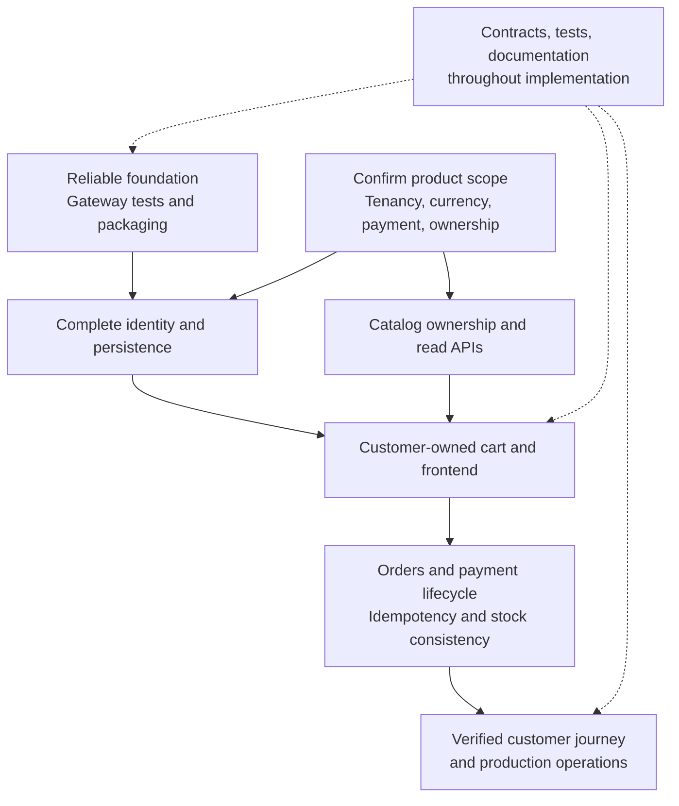

# Future plans

[Documentation hub](../README.md) · [Current implementation status](../operations/implementation-status.md)

**Status:** Proposed work and draft requirements. **Reviewed:** 2026-10-21.
These documents do not describe available features or approved delivery dates.

## Roadmap and design index

| Area                          | Documents                                                                                                    | Purpose                                                          |
| ----------------------------- | ------------------------------------------------------------------------------------------------------------ | ---------------------------------------------------------------- |
| Execution                     | [Implementation plan](implementation-plan.md)                                                                | Dependencies, backlog IDs, acceptance criteria                   |
| Product                       | [PRD](product/prd.md), [features](product/feature-specification.md), [UI/UX](product/ui-ux-specification.md) | Draft first-storefront scope and customer journey                |
| Platform                      | [Target platform design](architecture/platform-design.md)                                                    | Proposed service boundaries, identity, and consistency decisions |
| Data                          | [Commerce data model](architecture/commerce-data-model.md)                                                   | Proposed catalog/cart/order ERD and constraints                  |
| Contracts                     | [Product API](api/product-api.md)                                                                            | Draft `/v1` endpoints and future error format                    |
| Refactoring                   | [Auth structure](architecture/auth-service-structure-plan.md)                                                | Feature ownership and gradual file moves                         |
| Concurrency and configuration | [Redis/runtime plan](architecture/redis-and-runtime-plan.md)                                                 | Atomic OTP handling, shared quotas, production configuration     |
| Operations                    | [HTTP lifecycle plan](architecture/http-lifecycle-plan.md)                                                   | Readiness, request draining, client cleanup                      |

## Proposed delivery sequence

This is a dependency sketch, not a schedule. The
[implementation plan](implementation-plan.md) owns task-level dependencies.
Refactor work should preserve current contracts; functional identity changes
need their own implementation and validation.

## Integration direction

Next.js is the proposed storefront. Kafka, Socket.IO, Firebase, TensorFlow.js,
AWS, and Cloudflare remain directions without implemented integrations.
The media provider is unconfirmed; earlier notes suggested ImageKit, but no
adoption decision or configuration is present. Redis is already used for OTP;
additional caching/shared-gateway use is future work.

Before implementation, confirm single-store versus tenant scope, credential and
session strategy, service/data ownership, stock consistency, payment/tax/shipping,
and operational responsibility. No owner assignments, dates, or approval records
are invented by these drafts.

When a plan ships, update the current architecture/reference/guide pages,
record checks, and revise the task status. Current behavior always belongs
outside this folder; use [architecture](../architecture/overview.md) and
[API reference](../reference/api.md) for today's contracts.
