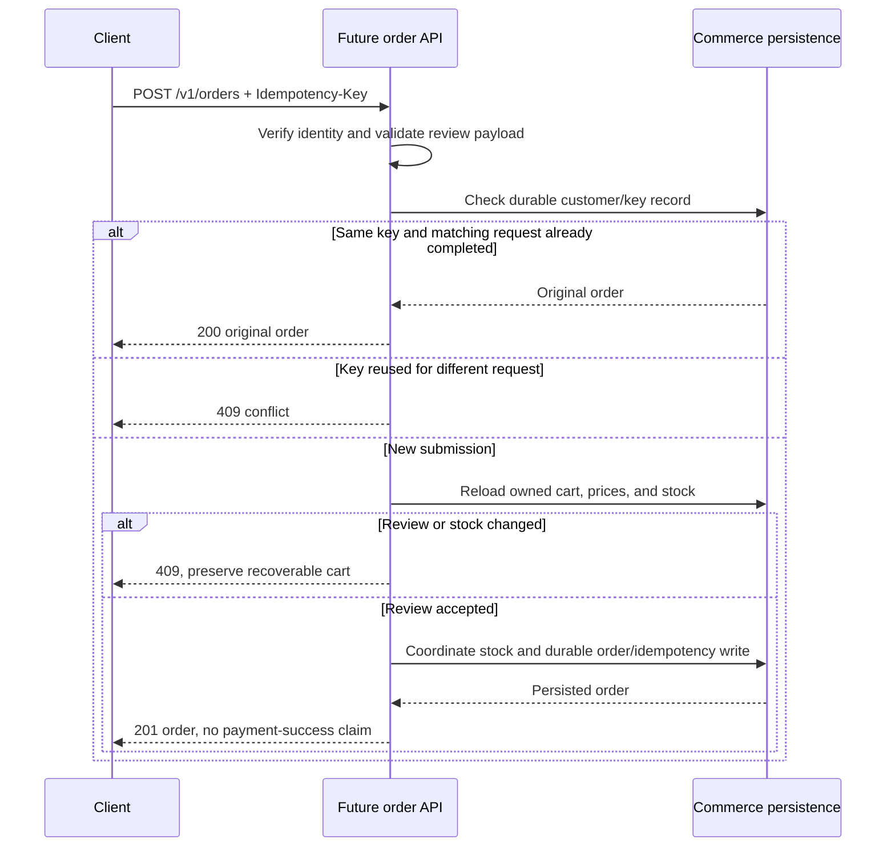

# Proposed product API

[Future plans](../README.md) · [Current API](../../reference/api.md)

**Status:** Draft; none of these routes are implemented. **Reviewed:** 2026-10-25.

The Next.js client now has a scaffold and design tokens, but consumes none of
these APIs. Its `/api/hello` handler is unrelated to the proposed `/v1` contract.

This draft supports the [feature specification](../product/feature-specification.md).
`/v1` is a proposed public prefix, not an existing route. Requests to these paths
currently forward to auth and have no product handlers. Session transport, exact
limits, service routing, and checkout lifecycle require decisions before implementation.

The draft direct-registration contract below differs from the current OTP request
endpoint. Decide how verification and compatibility fit before adopting it;
documenting `/v1/auth/register` does not replace `/api/user-registration`.
Likewise, current `POST /api/login` already returns a public user projection and
sets `access_token`/`refresh_token` JWT cookies. The `/v1` login below is a proposal,
not an alias. Current token expiries, cookie policies, and differentiated 400/401
failures belong to the [current login contract](../../reference/api.md#login-and-jwt-cookies).

### Common draft conventions

- JSON request/response bodies; IDs serialized as strings, dates as UTC ISO 8601.
- Money is integer minor units plus currency, calculated by the server.
- Customer identity comes from verified credentials; clients cannot choose an owner.
- Paginated lists return `{ "items": [], "nextCursor": null }`; draft limit defaults
  to 20 with maximum 100. Cursor uses createdAt plus ID for stable descending order.
  Invalid limits, IDs, or cursors return 400. These values are proposals.
- Mutations validate an explicit set of accepted fields rather than accepting
  arbitrary objects. Unexpected failures expose no stack traces or credentials.

### Draft endpoints and contracts

| Method / path                       | Access   | Request                                                                                        | Success                                                       | Main failures                                                              |
| ----------------------------------- | -------- | ---------------------------------------------------------------------------------------------- | ------------------------------------------------------------- | -------------------------------------------------------------------------- |
| POST `/v1/auth/register`            | Public   | `{ email, password }`                                                                          | 201 `{ user: { id, email } }`; does not imply automatic login | 400 invalid input, 409 duplicate, 429 limited                              |
| POST `/v1/auth/login`               | Public   | `{ email, password }`                                                                          | 200 `{ user: { id, email } }` plus chosen session transport   | 400 invalid input, 401 generic credentials failure, 429                    |
| POST `/v1/auth/logout`              | Customer | No body                                                                                        | 204; invalidate current session                               | 401 absent/expired session                                                 |
| GET `/v1/auth/me`                   | Customer | No body                                                                                        | 200 `{ user: { id, email } }`                                 | 401 absent/expired/revoked session                                         |
| GET `/v1/products`                  | Public   | Optional `cursor`, `limit`                                                                     | 200 paginated product summaries                               | 400 invalid query                                                          |
| GET `/v1/products/{id}`             | Public   | Product ID                                                                                     | 200 product detail                                            | 400 invalid ID, 404 missing/inactive                                       |
| GET `/v1/cart`                      | Customer | No body                                                                                        | 200 cart, including empty items                               | 401                                                                        |
| PUT `/v1/cart/items/{productId}`    | Customer | `{ quantity, expectedVersion }`; positive integer quantity                                     | 200 updated cart with new version                             | 400 invalid, 401, 404 missing/inactive product, 409 stock/version conflict |
| DELETE `/v1/cart/items/{productId}` | Customer | `expectedVersion` query                                                                        | 200 updated cart; missing line is a no-op if version matches  | 400, 401, 409 stale version                                                |
| POST `/v1/orders`                   | Customer | `Idempotency-Key` header; `{ cartVersion, expectedTotalMinor, currency }` draft review payload | 201 new order; 200 matching retry with same order             | 400 invalid/empty cart, 401, 409 price/stock/version or conflicting key    |
| GET `/v1/orders`                    | Customer | Optional `cursor`, `limit`                                                                     | 200 paginated own orders                                      | 400, 401                                                                   |
| GET `/v1/orders/{id}`               | Customer | Order ID                                                                                       | 200 own order detail                                          | 400, 401, 404 missing or other owner's order                               |

Registration persists only a normalized email and password hash. Login issues the
chosen credential; logout revokes it. Credential storage/transport and CSRF policy
remain design decisions for this `/v1` draft, so it does not specify cookie names,
token fields, lifetimes, or refresh endpoints. This does not override the existing
`/api` JWT-cookie implementation. Verification/recovery require separate approved contracts.

Product summary: `{ id, name, priceMinor, currency, stockQuantity }`; detail adds
`description`. Cart: `{ id, version, items, totalMinor, currency }`; each line has
`productId`, `name`, `quantity`, `unitPriceMinor`, and availability. An empty cart
has zero total; its currency policy is decided with catalog configuration.

Order: `{ id, status, currency, totalMinor, items, createdAt }`; lines have
`productId`, `productName`, `quantity`, `unitPriceMinor`. The accepted total is
server-calculated; the client's expected total only detects changes, never sets
the price. Status values and shipping/tax/payment payloads remain blocked on
lifecycle decisions. The draft request must be revised if those add to the total.

Order submission reloads the customer's cart and prices, verifies the review
version/total, and coordinates stock with a durable order write. Matching key and
request returns the original order; mismatching reuse is 409. Clearing the cart
must not prevent recovery after a failed submission. No payment callback or
payment success is implied by an order response.

### Proposed order-submission flow

This illustrates the draft order contract, not a current endpoint. Stock/order
coordination still needs a transaction or compensation decision.



### Proposed error envelope

```json
{
  "error": {
    "code": "VALIDATION_ERROR",
    "message": "Review the submitted fields.",
    "fields": { "quantity": "Use a positive integer." }
  }
}
```

`fields` is optional. Proposed codes distinguish validation, unauthorized,
not-found, conflict, rate-limit, and internal failures. Proposed gateway upstream
mapping: 502 for failed connections, 504 for upstream timeout, sanitized 500 for
unexpected internal errors. This mapping is not implemented. Existing 429 uses
`{ "error": "Too many requests, please try again later" }`; harmonizing it needs
an explicit compatibility change, not a documentation-only assumption.

### Contract delivery

Implement and test ownership, validation, repeat requests, conflicts, and upstream
failure with each endpoint. Publish executable OpenAPI only for available routes
and align examples with the implementation. See [proposed platform design](../architecture/platform-design.md)
and [implementation plan](../implementation-plan.md).
