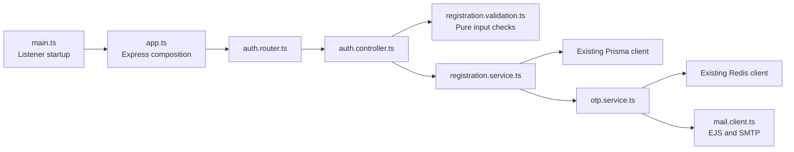

# Auth-service folder structure plan

[Documentation index](../../README.md) · [Current authentication flow](../../development/authentication.md)

**Date:** 2026-10-22. **Status:** Proposed refactor; these moves have not been made.
This plan reorganizes existing ownership without changing public endpoints.
Advanced Redis and port configuration are deferred; see the
[Redis and runtime plan](redis-and-runtime-plan.md).

## Goal and boundaries

Keep the existing Nx applications and one shared `packages/` workspace. Auth owns
registration, OTP policy, identity, and activation email presentation. The gateway
owns public routing, trusted proxies, and its traffic limits. Errors and database clients keep their existing owners. HTTP lifecycle is
[deferred](http-lifecycle-plan.md); there is no shared HTTP module currently.
Keep environment reads local and use the existing PORT convention.

The current issue is mixed responsibilities: `main.ts` builds and starts Express,
`auth.helper.ts` combines validation with Redis policy and mail orchestration, and
the controller performs database access, password hashing/comparison, and JWT
signing. Cookie policy currently lives in `utils/cookies/setCookies.ts`.
Adding directories alone will not solve
those responsibilities. Move them in small, behavior-preserving steps.

## Proposed target

```text
apps/auth-service/
|-- package.json                 # App dependencies, Nx build/assets targets
|-- Dockerfile
|-- jest.config.cts
`-- src/
    |-- main.ts                  # Start Express directly; keep bootstrap small
    |-- app.ts                   # Create Express app; CORS, parsing, routes, errors
    |-- auth/
    |   |-- auth.router.ts       # Preserve existing /api registration, verification, and login routes
    |   |-- auth.controller.ts   # HTTP input/output and error forwarding
    |   |-- registration.service.ts  # Email lookup and OTP delivery orchestration
    |   |-- registration.validation.ts # unknown -> validated, normalized input
    |   |-- login.service.ts     # Existing credential comparison and token issuance
    |   |-- cookies.ts           # Existing cookie policy moved with the feature
    |   |-- otp.service.ts       # Existing OTP rules; future atomicity when needed
    |   |-- registration.validation.spec.ts
    |   |-- registration.service.spec.ts
    |   `-- otp.integration.spec.ts
    |-- mail/
    |   |-- mail.client.ts       # Nodemailer, template rendering, SMTP acceptance
    |   |-- mail.client.spec.ts
    |   `-- templates/
    |       `-- user-activation-mail.ejs
    |-- docs/
    |   |-- swagger.js          # Generation input/script
    |   `-- swagger-output.json # Only implemented HTTP contracts
    `-- app.spec.ts             # HTTP contracts without a production listener

packages/                        # Existing single workspace and tsconfig
|-- error-handler/               # Shared errors and safe response handling
`-- libs/
    |-- prisma/                  # Prisma client lifecycle
    `-- redis/                   # Redis connection lifecycle
```

Create files as responsibilities move; do not create empty folders or placeholder
modules. Existing login and verification, and future session lifecycle work, stay in `auth/` until their size
and independent ownership justify another feature folder. There is no need for
per-folder `package.json`, `tsconfig.json`, generic repository interfaces,
dependency-injection containers, or base controllers.

## Responsibility rules

The following dependency direction is proposed; the current helper still mixes
validation, Redis policy, and mail orchestration.



| File / owner            | Receives                                   | Returns / side effects                                 |
| ----------------------- | ------------------------------------------ | ------------------------------------------------------ |
| Router                  | Express requests                           | Routes to controllers; no database or OTP operations   |
| Controller              | Untrusted request body                     | Validates input, invokes service, sends HTTP response  |
| Registration validation | `unknown`                                  | Normalized typed data or `ValidationError`; no I/O     |
| Registration service    | Validated registration data                | Looks up email and orchestrates OTP; no Express `next` |
| OTP service             | Normalized email, name, template           | Owns OTP TTLs, limits, and delivery flow               |
| Mail client             | Recipient, template, render data           | Throws on rendering/SMTP failure; owns transport close |
| App                     | App configuration                          | Express app without listening or signal handlers       |
| Main                    | Startup configuration and concrete clients | Starts listener; logs listener errors                  |

Use concrete modules and functions. Inject a dependency only when a focused HTTP
test needs to replace it; do not build a generic service registry. Keep Prisma
queries in the owning service until multiple queries justify a dedicated data
module. Never share auth business rules through `packages/libs`.

## Migration sequence

1. **Separate app creation from startup.** Move CORS, parsers, Swagger, router,
   error middleware into `app.ts`. Keep app.listen() in `main.ts`.
   Add readiness/shutdown only through the separate future lifecycle work. Keep greeting and health contracts intact.
2. **Move the feature together.** Move `routes/auth.router.ts` and
   `controller/auth.controller.ts` into `auth/`; update imports. Keep
   all three `/api` POST contracts unchanged, including JWT claims and cookie
   attributes. Improve behavior in separate changes with explicit validation.
3. **Split the helper by responsibility.** Move validation into
   `registration.validation.ts`, OTP restrictions/storage into `otp.service.ts`, and email
   lookup/orchestration into `registration.service.ts`. Add focused tests with each responsibility; no current auth unit tests need moving. Delete the old helper after all callers have moved.
4. **Group API documentation and retain mail ownership.** Move Swagger files
   under `src/docs/`; mail already has its own module/templates directory.
   Update Swagger imports and generator paths. If mail paths change, update
   build asset inputs and bundled template resolution in the same change.
   Keep runtime `dist/templates` and `dist/prisma/schema.prisma` contracts stable.
5. **Verify the move.** Run targeted unit/Redis integration tests,
   typechecking, builds, and a container OTP check. Inspect generated manifests,
   Linux Prisma generation and normal listener startup. Update documentation
   only with actual results.

## Separate functional follow-ups

Verification is already routed and implements OTP comparison, attempt lockout,
password hashing, and user creation. Login is routed and signs JWT cookies.
Separate functional follow-ups are consistent validation/normalization, clean OTP
error propagation without Express `next`, atomic single-use consumption,
unique-email race handling, token verification/protected requests, refresh/logout,
and browser/CSRF policy. A folder refactor does not establish those behaviors or
verify live authentication.

The OTP record remains a string at `otp:<normalized-email>`, expiring after
300 seconds. Cooldown expires after 60 seconds. No Lua scripts, ownership tokens,
Redis hash migration, or gateway Redis store are currently introduced. Future
verification hardening must use the same normalization and storage format unless a separate
migration is explicitly implemented. Registration does not persist passwords.

## Acceptance checklist for the future refactor

- [ ] One dependency direction: router -> controller -> service -> infrastructure.
- [ ] No Express `Request`, `Response`, or `next` in OTP or registration services.
- [ ] No listener or signal-handler side effects when importing `app.ts`.
- [ ] Current URLs, response bodies, validation limits, and OTP TTLs preserved.
- [ ] Validation and error-propagation tests added; future atomicity covered when implemented.
- [ ] Template and Prisma assets present in the deployable output.
- [ ] App manifests, project references, Jest aliases, and documentation aligned.
- [ ] Relevant checks actually run and results recorded before claiming success.

## Broader workspace direction

Keep gateway policy in `apps/api-gateway`; do not create a separate microservice
for each future entity. Add catalog/cart/order owners only with concrete workflows
and data boundaries. Keep pure shared modules separate from client barrels that
instantiate connections. Add shared code when two real consumers need it.

No new framework or folder-per-layer hierarchy is needed to follow this plan.
