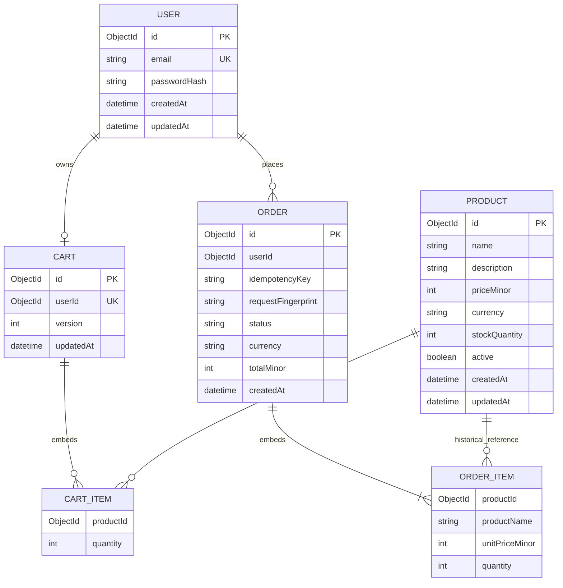

# Proposed commerce data model

[Future plans](../README.md) · [Current schema](../../architecture/database-design.md)

**Status:** Draft; only users/images exist in the current Prisma schema. **Reviewed:** 2026-10-25.

The client scaffold and Tailwind tokens introduce no commerce models, catalog
seed data, or cart/order persistence. The externally supplied prototype's demo
storage is not a database implementation or a production contract.

## 1. Ownership and modeling

Auth owns identity. Commerce ownership and physical database separation are
undecided. References across boundaries are not enforced foreign keys or permission
to access another service's database. This draft assumes one storefront; tenancy
would require reviewing every key, index, and ownership check.

MongoDB collections replace relational tables here. Cart/order lines are embedded;
users and products are independently addressable. This is a logical ERD, not SQL.

## 2. Proposed ERD

PK/UK denote intended identifiers/unique indexes. User/product references are
logical; order snapshots survive later product changes or removal.

## 3. Collections, constraints, and indexes

| Collection | Proposed constraints                                                                         | Proposed indexes / use                                                    |
| ---------- | -------------------------------------------------------------------------------------------- | ------------------------------------------------------------------------- |
| `users`    | Normalized unique email; never expose passwordHash                                           | Unique email; default `_id`                                               |
| `products` | Nonempty name; nonnegative integer price/stock; currency                                     | `(active, createdAt, _id)` for stable catalog pagination                  |
| `carts`    | One per customer; unique product lines; positive integer quantities; versioned updates       | Unique `userId`                                                           |
| `orders`   | Nonempty items; immutable snapshots; consistent currency; server total; matching key/request | Unique `(userId, idempotencyKey)`; `(userId, createdAt, _id)` for history |

Validate in the owning service and apply database constraints where supported.
Embedded-array indexes do not by themselves enforce unique products inside one
cart; validate or update atomically. Decide string/item/quantity limits, currency
precision, and overflow bounds before implementation.

## 4. Consistency and deletion

Cart edits use an expected version to avoid lost updates. Order creation needs
idempotency, price snapshots, stock checks, and durable writes without negative
inventory or lost carts. Decide a transaction/reservation strategy and verify its
database topology before checkout. Cross-service transactions are not assumed.

Archive products without rewriting historical lines. Account anonymization,
order retention, session cleanup, backups, and deletion obligations are undecided.
Add payment/fulfillment models only after their lifecycle is specified. Session
storage is deliberately absent until the identity strategy is chosen.

## 5. Delivery and checks

Build on the initial users/images schema with service integration, reviewed index
creation, repeatable seed data, and verified environment setup. Establish a connector-appropriate schema
deployment process; SQL migration behavior is not implied. Verify concurrent
uniqueness, cart conflicts, order retries, stock consistency, and backup restore.
See [proposed platform design](platform-design.md) and [plan](../implementation-plan.md).
