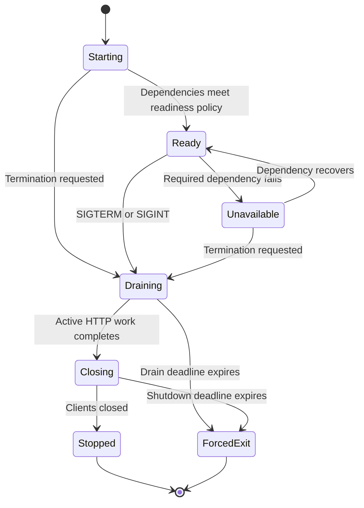

# Future HTTP readiness and shutdown plan

[Documentation index](../../README.md) · [Auth-service structure plan](auth-service-structure-plan.md)

**Updated:** 2026-10-21. **Status:** Deferred until deployment needs it.

## Current implementation

Each application's main.ts starts Express directly with app.listen(). Auth uses
PORT or 6001; gateway uses PORT or 8080. Listener errors are logged and set a
nonzero exit code. Normal Node/operating-system behavior handles termination.

No shared packages/http module, /ready routes, dependency probes, custom HTTP
receipt timeouts, or signal/drain handlers are present. There are no
custom readiness checks or graceful resource cleanup at present. Auth GET /
and gateway GET /gateway-health are local responses, not dependency checks.
The gateway's ten-second upstream proxy timeout remains separate and unchanged.

## When to implement

Implement this before deploying behind an orchestrator or load balancer that
needs readiness-based routing and rolling releases. It is unnecessary for the
current local development stage.

## Smallest implementation sequence

This is the proposed lifecycle, not behavior implemented by the current servers.

1. Define the deployment's probe interval and termination grace period first.
   Keep liveness separate from readiness: a dependency outage should remove
   traffic without automatically creating a restart loop.
2. Add an app-local readiness route with explicit dependencies. Decide whether
   MongoDB, Redis, SMTP, and upstream auth failures should block each service.
   Return only ready/unavailable status, with no connection details or secrets.
3. Bound probe responses and dependency operations. A Promise.race response
   deadline alone does not cancel the underlying operation; use supported client
   timeouts/cancellation and avoid overlapping unbounded probes.
4. Handle SIGTERM/SIGINT once in each executable entry point. Mark the service
   unavailable, stop accepting new HTTP work, and drain active requests before
   closing Prisma, Redis, and mail resources.
5. Add a shutdown deadline shorter than the platform's grace period. Define
   forced-exit behavior, failure logging, and exit codes. Include long-running
   requests and keep-alive connections in the policy.
6. Choose HTTP header/request receipt timeouts based on actual traffic. Keep them
   distinct from application response deadlines and upstream proxy timeouts.

Start with code in main.ts. Extract a shared HTTP helper only when both apps have
the same proven lifecycle requirements; no framework or extra package is needed.
Keep the existing PORT convention and defaults.

## Validation when the work is requested

- [ ] Healthy and unavailable dependency probes return the expected status.
- [ ] A hanging dependency cannot accumulate unbounded work or block probes.
- [ ] Shutdown makes readiness fail and stops new traffic before cleanup.
- [ ] Active requests drain before database, Redis, and SMTP clients close.
- [ ] Stuck requests hit the configured deadline with the expected exit code.
- [ ] Listener failure exits correctly without leaving client handles alive;
      the current exitCode-only handler does not establish this.
- [ ] Local Ctrl+C and container SIGTERM behave as documented.
- [ ] Record actual test/container results and update API/deployment docs.

These are future acceptance criteria. Current termination can interrupt requests;
the plan does not establish successful shutdown behavior.
