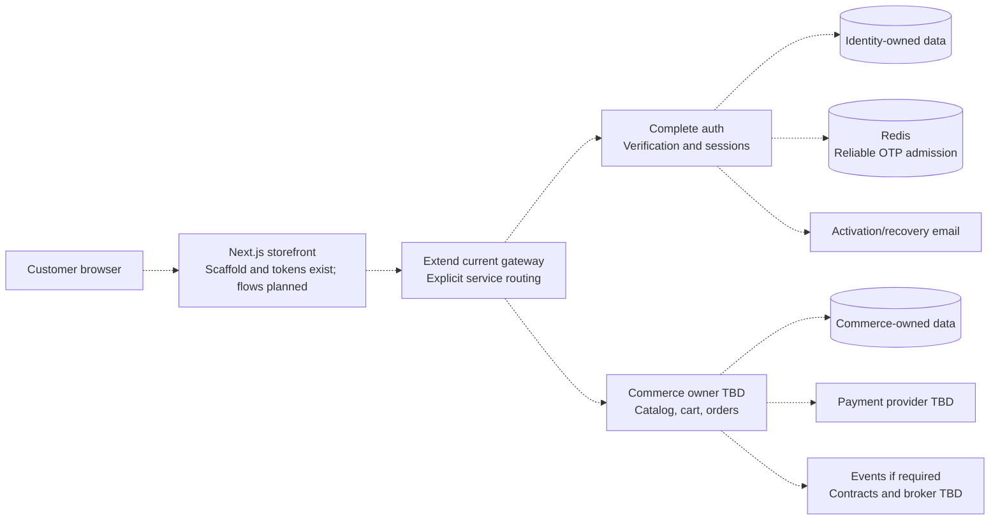

# Proposed platform design

[Future plans](../README.md) · [Current architecture](../../architecture/overview.md)

**Status:** Draft target and open decisions. **Reviewed:** 2026-10-25.
The diagram is a proposed system; it does not describe deployed components.

## Target system

Dashed arrows describe target interactions. Auth and gateway have current
implementations, including OTP/account creation and login/JWT cookie issuance;
the full identity lifecycle and commerce flows shown here are unfinished. Logical data ownership
does not mandate separate physical MongoDB deployments. Do not create a new
service for every entity without a workflow and ownership reason.

The current client contains a header with the shared Input/icons and a placeholder page with
[Tailwind design tokens](../../reference/design-tokens.md). The frontend-to-API
arrows above are future integration; the scaffold makes no backend calls.

## Proposed request pattern

Validate in the receiving service even when the gateway validates. Derive
ownership from verified credentials, not arbitrary customer IDs. Keep transport
and business code separate when behavior warrants it; no framework is selected.

## Decisions to make

| Topic      | Proposed direction                                                                 | Decision gate                                                                          |
| ---------- | ---------------------------------------------------------------------------------- | -------------------------------------------------------------------------------------- |
| Identity   | Auth owns hashing, verification, session issue/revocation                          | Storage, transport, expiry, recovery; CSRF policy for cookies                          |
| Gateway    | Explicit routing and failure policy                                                | Startup validation, proxy topology, 502/504 mapping and retry policy                   |
| Access     | Service-level identity and ownership checks                                        | Reject spoofed identity and cross-customer resource access                             |
| Data       | MongoDB/Prisma with service-owned collections                                      | Connector topology, unique indexes and deployment process                              |
| Money      | Integer minor units and explicit currency; server totals                           | Bounds, precision, shipping/tax and rounding                                           |
| Orders     | Durable customer/idempotency-key uniqueness plus request fingerprint               | Matching retries reuse order; conflicting key reuse returns 409                        |
| Frontend   | Next.js scaffold and Tailwind tokens exist; consuming public APIs remains proposed | Component system, state/cache choices, identity integration, and full interface states |
| Async      | Add messaging only for agreed workflows                                            | Schemas, replay, delivery and failure ownership                                        |
| Operations | Readiness, drain, monitored dependencies, recoverable data                         | Platform probe/grace periods, backups, logs and rollback                               |

Parsed cookies or identity headers alone do not establish a session. Avoid
client-chosen prices or unfiltered objects in database writes. Define safe
public errors and structured/correlated logging; do not log credentials or
personal request payloads.

Current auth signs access/refresh JWTs but has no consuming authentication
middleware, refresh/rotation endpoint, logout, or revocation state. The existing
fixed role and Secure/HttpOnly/SameSite=None cookie policy are the baseline to
review when deciding production identity and browser security, rather than a
completed implementation of this target. See [current authentication](../../development/authentication.md).

## Consistency and rollout

Cart updates need a version/conflict policy. Checkout must reload prices and
stock, coordinate durable orders with stock updates, preserve recoverable cart
state on failure, and prevent duplicate orders. Choose a transaction,
reservation, or compensating strategy against the actual database topology;
cross-service transactions are not assumed.

[Commerce data model](commerce-data-model.md) owns the draft ERD and indexes.
[Product API](../api/product-api.md) owns proposed request/response contracts.
Payment confirmation, refunds, retention, and tenant isolation need separate
product decisions. An order response does not prove payment succeeded.

Roll out schema/index changes with reviewed deployment steps and backup/restore
checks. Introduce permanent validation, credential, ownership, concurrency,
retry, and upstream-failure tests with each behavior. Operational follow-ups are
in [Redis/runtime](redis-and-runtime-plan.md) and
[HTTP lifecycle](http-lifecycle-plan.md). Task acceptance belongs in the
[implementation plan](../implementation-plan.md).
