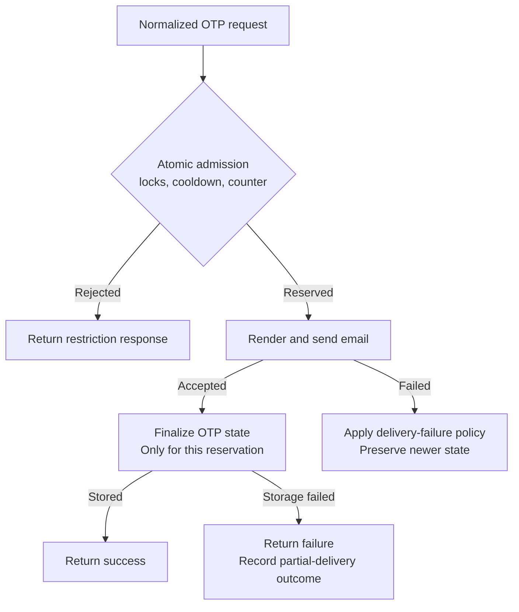

# Redis and runtime configuration plan

[Documentation index](../../README.md) · [Auth-service structure plan](auth-service-structure-plan.md)

**Updated:** 2026-10-21. **Status:** Future work, not an implementation claim.

## Current baseline

- Keep the existing client: `new Redis(process.env.REDIS_DATABASE_URL!)`.
- Keep OTP values as strings with a 300-second expiry and a 60-second cooldown.
- Keep the existing sequential `GET`/`SET` restrictions and request counter.
  Helpers throw errors so registration stops when a restriction fails.
- Keep the gateway's default in-memory IP limiter. It does not import Redis.
- Keep `PORT`: auth defaults to 6001, gateway to 8080. Leave it unset when
  launching both with `npm run dev`; override it in a service's own environment.
- Gateway uses a simple `AUTH_SERVICE_URL` override, defaulting to
  `http://localhost:6001`. Changing auth's port requires updating that URL.
- Load dotenv at application startup. No shared config package, custom port
  parser, `AUTH_PORT`, or `GATEWAY_PORT` is required now.

There are no Lua admission scripts, ownership tokens, OTP hashes, Redis-backed
gateway store, custom Redis options, integration suites, or shared configuration
layer in the current source. See [current authentication](../../development/authentication.md).

## Phase 1: Finish the local authentication flow

Complete verification, password hashing, and user creation before introducing
more infrastructure. Validate normalized email consistently, stop on restrictions,
and propagate mail failures. Keep configuration in environment variables; do not
log credentials or copy `.env` into images.

Confirm the installed ioredis client receives a TCP `redis://` or `rediss://` URL
when the connection is verified. A provider's HTTPS REST endpoint is a different
API. Do not change client libraries without a concrete requirement.

## Phase 2: Before public concurrent traffic

The following admission/delivery flow is proposed. It replaces the current
sequential checks only when implemented and tested.

SMTP and Redis cannot commit atomically together. The exact reservation format,
expiry, compensation, and OTP-write timing require a decision; this sketch does
not assert a selected Lua implementation or a solved delivery transaction.

1. Make OTP admission atomic: lock checks, cooldown reservation, and request
   counting must happen together. Separate awaited `GET`/`SET` calls can overlap
   even in one Node process.
2. Define delivery failure behavior. Redis and SMTP cannot commit together;
   preserve the original error and ensure failed attempts cannot delete newer
   state. Do not report SMTP acceptance as guaranteed inbox delivery.
3. Add wrong-code attempt limits and single-use OTP consumption with verification.
4. Add focused tests for simultaneous requests, expiry, delivery/storage failures,
   lockout, and replay against a dedicated test Redis instance.
5. Add bounded connection/command behavior, safe connection error reporting,
   readiness, and explicit Redis shutdown if deployment requirements need them.
   Use a few client options; do not introduce a client factory or wrapper by default.

Keep the current key/value format unless a change is needed. If it changes, define
how pending OTPs and locks survive deployment or expire before rollout.

## Phase 3: Only when gateway replicas are introduced

Move IP counters to a shared store so each replica enforces the same limit. Prefer
a maintained express-rate-limit Redis adapter over a custom store class. Define
counter prefixes, expiry, and Redis outage behavior, then verify limits across two
instances. Keep the in-memory store until this deployment need exists.

## Ports and networking

Use the same `PORT` variable separately in each service deployment. For example,
auth can receive `PORT=6001` while gateway receives `PORT=8080`; separate
containers can also both listen on 3000 internally because they have separate
network namespaces. Host-published ports are configured by Docker or the platform.

For local simultaneous startup, keep defaults. For a custom auth port, launch it
in its own terminal and set `AUTH_SERVICE_URL` in the gateway's environment to
match. In separate containers, use the auth service's network hostname instead of
localhost. Keep HTTP ports separate from inspector ports 9229/9230.

Before production, validate a configured port as an integer between 1 and 65535
near the listener. Extract a shared parser only if real consumers need the same
policy. Configure trusted proxy addresses for the actual ingress topology; do not
enable blanket proxy trust. The gateway currently uses Express's no-trust default.

## Checks for the future implementation

- [ ] Complete registration and verification behavior first.
- [ ] Reproduce concurrent OTP admission before implementing its fix.
- [ ] Verify failures and expiry using isolated Redis data.
- [ ] Verify shared limits only when replicas are deployed.
- [ ] Verify local, custom-port, and container upstream addresses.
- [ ] Run requested tests/builds and record actual outcomes.

This plan does not implement or verify Redis behavior. Known limits remain:
sequential OTP operations can race, gateway counters are
per-process, and SMTP can accept an email before a later Redis write fails.
