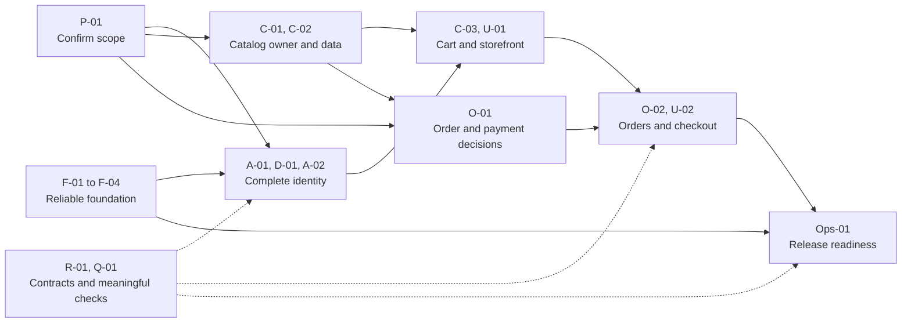

# Implementation Plan & Task Breakdown

[Documentation index](../README.md)

**Priority:** Critical. **Status:** Proposed backlog, not a committed schedule.
**Reviewed:** 2026-10-25. Owner columns suggest responsibility; no actual owner
assignments, estimates, tickets, or dates are supplied.

## 1. Starting point

Gateway/auth tooling, OTP delivery, and registration verification with account
creation exist. Login now compares password hashes and issues access/refresh JWT
cookies. A complete identity lifecycle (protected requests, refresh/rotation,
logout/revocation), customer purchase journey, and production infrastructure do not.
[Implementation status](../operations/implementation-status.md) tracks evidence.
Prisma 6.19 and users/images provide part of D-01; F-02/F-03/F-04, A-02, and R-01 also
have partial source work. Every task below remains open until its full acceptance
criteria are met. The Dockerfile is still a single-stage scaffold without an
explicit Prisma generation step; current packaging is not a completed task.

A-02 now includes implemented login/token issuance, and R-01 includes corrected
`/api` Swagger paths and required request/success examples. Their remaining gates
include validation/error consistency, cookie/browser policy, token verification
and lifecycle, detailed error/cookie documentation, and permanent contract tests.

The client scaffold now exists with Next.js/React, Tailwind/PostCSS, the original
header and placeholder page, and the supplied
[design tokens](../reference/design-tokens.md). This is partial U-01 foundation,
not completion: identity/catalog/cart screens, API integration, localization,
theme controls, responsive component behavior, and client tests remain open.
The separate `npm run client` command starts its `dev` target.

## 2. Tasks and acceptance criteria

| ID     | Task / proposed owner                              | Depends on                   | Done when                                                                                                              |
| ------ | -------------------------------------------------- | ---------------------------- | ---------------------------------------------------------------------------------------------------------------------- |
| F-01   | Align gateway HTTP tests / gateway                 | None                         | Port/setup/teardown match 8080; health asserted; forwarding explicitly starts auth                                     |
| F-02   | Correct runtime manifests/packaging / app owners   | None                         | Imports declared per app; pruning/image startup verified when requested                                                |
| F-03   | Upstream config and failure contract / gateway     | None                         | Address configurable; ports validated; log correct; timeout/status checks                                              |
| F-04   | Client identity and limiting / gateway             | None                         | Trust matches topology; IPv6/spoofing covered; body size/order reviewed                                                |
| P-01   | Confirm first-slice scope / product owner TBD      | None                         | Tenancy, guest identity, currency, tax, shipping, catalog management decided                                           |
| A-01   | Select identity contract / auth                    | P-01                         | Credential/session/verification/recovery and browser security recorded                                                 |
| D-01   | Identity persistence / auth                        | A-01                         | Datastore configured; unique normalized email; protected hashes; repeatable schema/index setup                         |
| A-02   | Register/login/logout/me / auth                    | D-01, F-03, F-04             | Validation, expiry/revocation, ownership/failures checked; API matches                                                 |
| C-01   | Commerce ownership/model / owner TBD               | P-01                         | Product/cart/order and stock/consistency ownership decided; ERD revised                                                |
| C-02   | Catalog read and seed/operator process / commerce  | C-01                         | Stable listing/detail; active/stock rules; repeatable data maintenance                                                 |
| C-03   | Customer cart / commerce                           | A-02, C-02                   | Quantity bounds, persistence/concurrency, cross-user rejection checked                                                 |
| U-01   | Next.js identity/catalog/cart / frontend owner TBD | A-02, C-02, C-03             | States, responsive navigation, keyboard flows, APIs verified                                                           |
| O-01   | Order/payment lifecycle / product + commerce       | P-01, C-01                   | Provider, stock reservation, amount rules, fulfillment boundaries recorded                                             |
| O-02   | Orders and payment integration / commerce          | C-03, O-01                   | Stable snapshots; idempotency; stock/failure behavior; ownership; provider-specific security and confirmation verified |
| U-02   | Checkout/order screens / frontend                  | U-01, O-02                   | Changed cart reviewed; failure recovery; accurate order/payment confirmation                                           |
| R-01   | Executable API specification / API owners          | Feature routes               | OpenAPI/UI match real behavior; draft paths not presented as available                                                 |
| Q-01   | Meaningful CI behavior coverage / app owners       | F-01 and each feature        | Reliable explicit E2E; permanent behavior tests; actual results recorded                                               |
| Ops-01 | First-slice production operations / owner TBD      | F-02, F-03, F-04, O-02, U-02 | TLS/secrets/network, readiness/shutdown, logs/alerts, backup/restore, rollback verified                                |

Contracts can precede code; R-01 completion requires matching implementation.
Add Q-01 checks with each feature, not only after the full platform. Payment-specific
tasks must be refined after O-01; no provider endpoints are assumed.

## 3. Delivery increments

The graph groups task dependencies; the task table above owns the detailed
prerequisites. All nodes are future completion gates, including tasks with
partial source work.

1. **Reliable foundation:** F-01 through F-04. Exit with trustworthy health,
   forwarding, client identity policy, and clear packaging.
2. **Account/catalog:** P-01, A-01/D-01/A-02, C-01/C-02. Exit with safe identity
   and persistent customer-visible catalog APIs.
3. **Purchase flow:** C-03, U-01, O-01/O-02, U-02. Exit with a complete cart/order
   journey; paid checkout requires verified provider integration.
4. **Release readiness:** R-01, Q-01, Ops-01, progressed alongside features. Exit
   with recorded functional and operational validation.

## 4. Deferred integration triggers

| Direction            | Start when                                                                  |
| -------------------- | --------------------------------------------------------------------------- |
| Additional Redis use | OTP already exists; add caching/shared gateway counters for a concrete need |
| Kafka                | Agreed workflow requires durable events                                     |
| Socket.IO / Firebase | Defined live/push flow with consent and auth rules                          |
| TensorFlow.js        | Defined use case, data, evaluation criteria                                 |
| ImageKit             | Asset provider adoption confirmed                                           |
| SaaS tenancy/billing | Product and tenant-isolation requirements agreed                            |

## 5. Completion rules

A task needs implementation, consumers, permanent checks, configuration, and docs
matching acceptance criteria. Record commands/results; configured tasks are not
verification. Record checks that were not run separately. This documentation
change does not implement the backlog or establish runtime success.
