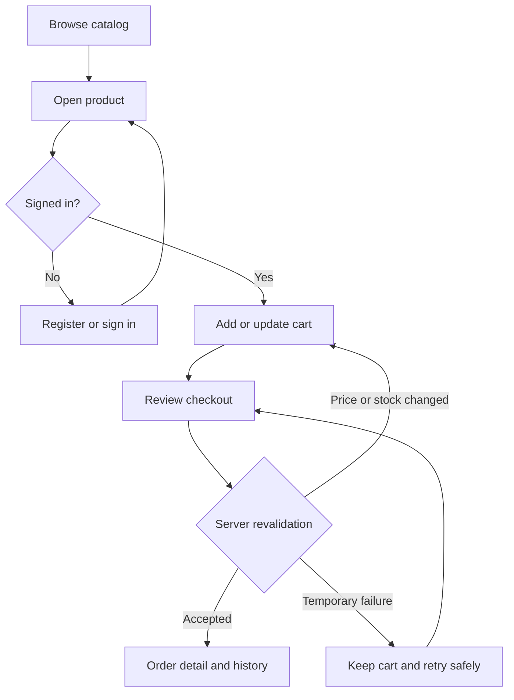

# UI/UX Specification

[Documentation index](../../README.md)

**Priority:** High. **Status:** Proposed storefront screens and flows.
**Reviewed:** 2026-10-25. A Next.js client scaffold and Tailwind design tokens
exist; the header uses the [shared Input and icons](../../reference/shared-ui.md)
and the page remains a placeholder. Shopping routes,
components, language controls, and theme controls are not implemented.

## 1. Screens and navigation

The table below proposes future storefront routes. The current client only has
its placeholder `/` page and `/api/hello` text handler. The externally supplied
enterprise design spec and README are design references; their prototype
features and localStorage behavior are not current application functionality.

| Proposed route   | Screen / user            | Content and actions                                   |
| ---------------- | ------------------------ | ----------------------------------------------------- |
| `/`              | Storefront / visitor     | Catalog entry and navigation                          |
| `/products`      | Catalog / visitor        | Products, pagination, availability, detail links      |
| `/products/[id]` | Product detail / visitor | Description, price, quantity, add to cart             |
| `/register`      | Registration / visitor   | Email/password, validation, sign-in link              |
| `/login`         | Login / visitor          | Credentials, generic failure, return to intended page |
| `/cart`          | Cart / customer          | Lines, quantity edit/removal, current total, checkout |
| `/checkout`      | Review / customer        | Review and submit; payment/shipping fields undecided  |
| `/orders`        | History / customer       | Own orders, dates, status, totals                     |
| `/orders/[id]`   | Order detail / customer  | Immutable item snapshots and status                   |

Use persistent catalog/cart/account navigation. Protected journeys lead to login
and return to a safe local destination afterward. API ownership remains required.
No admin console, tenant switcher, or subscription pages are assumed.

## 2. Core flow

Payment redirects and failure/confirmation screens depend on the provider and
order lifecycle. Never label an unverified order as paid or fulfilled.

## 3. Interface states

| Surface        | Proposed states and behavior                                                               |
| -------------- | ------------------------------------------------------------------------------------------ |
| Catalog/detail | Loading, populated, empty, missing, unavailable service, out of stock                      |
| Identity       | Idle, field validation, submitting, generic credentials error, success, rate limited       |
| Cart           | Loading, empty with catalog link, populated, updating, unavailable item, conflict, failure |
| Checkout       | Review, submitting, changed price/stock, recoverable failure, accepted order               |
| Orders         | Loading, empty, populated, not found, expired session, failure with retry                  |

Do not show failure as an empty list or a rejected mutation as success. Disable
repeat submission while pending; server idempotency still matters. On expiry,
prompt sign-in without exposing another user's data. Retain safe form input on
retry; do not persist passwords in browser storage.

## 4. Responsive and accessibility behavior

Use one column on narrow screens and expand grids on wider screens without
changing task order. Keep cart/checkout controls usable without horizontal scroll.
Use the implemented [Tailwind design tokens](../../reference/design-tokens.md):
indigo brand colors, light/dark semantic surfaces, Inter/system font stack,
12–60px type scale, 4px spacing unit, 8–24px named radii, and
`mobile/tablet/desktop` breakpoints at 390/768/1440px. The tokens supply styling
primitives; component variants, theme controls, and responsive screens remain work.

Use semantic headings, labels, visible keyboard focus, meaningful link text and
image alternatives. Associate field errors, announce async feedback, and avoid
color-only meaning. Define and verify an accessibility target before launch;
this draft does not establish conformance.

## 5. Content and dependencies

Format money with currency; distinguish estimated cart totals from final order
snapshots. Use concise actions: Sign in, Add to cart, Review changes. Checkout copy
depends on tax/shipping/payment. Branding, imagery, verification/recovery, and guest
checkout need decisions. [Feature specification](feature-specification.md) owns behavior.

English/Vietnamese, locale-aware formatting, persistent theme/language selection,
and system-theme preference are intended by the external design brief but are
not implemented. Prototype USD amounts, free shipping over $100, $12 shipping,
zero tax, 30-day returns, seeded products, and demo orders remain unapproved
business assumptions. Do not store real credentials or orders in localStorage;
production identity, pricing, inventory, ownership, and orders need server APIs.
