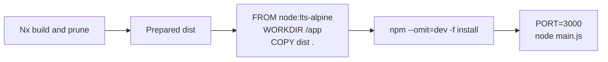
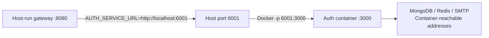
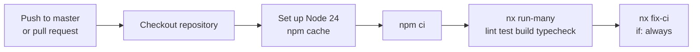

# Deployment and continuous integration

[Documentation hub](../README.md)

**Status:** Current packaging and workflow configuration. **Reviewed:** 2026-10-25.
Commands below are instructions, not evidence of successful image builds or runs.

## Build artifacts

| Project        | Configured output                                      | Packaging inputs                                                                                             |
| -------------- | ------------------------------------------------------ | ------------------------------------------------------------------------------------------------------------ |
| Auth           | `apps/auth-service/dist/main.js`, CommonJS via esbuild | Templates at `dist/templates`; schema at `dist/prisma/schema.prisma`; production lockfile generation enabled |
| Gateway        | `apps/api-gateway/dist`, Webpack                       | Assets, generated package metadata; explicit shared-source alias                                             |
| Shared library | `packages/dist`, TypeScript                            | JavaScript and declarations; one shared workspace manifest                                                   |
| Client         | `apps/client/.next`, Next.js                           | Next/React runtime and public assets; Tailwind CSS compiled by PostCSS                                       |

Both backend apps have prune-lockfile and copy-workspace-modules targets. Auth's Docker
build depends on build/prune. Inspect generated manifests, lockfiles, external
dependencies, copied workspace modules, and assets before treating dist as
deployable. Explicit auth dependencies do not list every root-provided runtime
import (for example dotenv, ioredis, bcryptjs, and jsonwebtoken); generated
packaging needs verification. JWT type declarations are a root development
dependency, not a substitute for runtime jsonwebtoken packaging.

## Client build and startup

```sh
npx nx build @microservice-eshop/client
npx nx start @microservice-eshop/client
```

Build before starting the production server. `npm run client` is development
mode; `npm run dev` starts only backend serve targets. The client is a placeholder
with tokens, not a production storefront. Its default origin is
`http://localhost:3000`, matching the backend CORS allowlist, but no API calls
are wired. No client Dockerfile, static-export setting, deployment integration,
or standalone output is configured. Do not assume `serve-static` inference makes
the app a deployable static export.

Theme selectors and scales live in
[packages/ui/theme.css](../../packages/ui/theme.css), imported and compiled by
[global.css](../../apps/client/src/app/global.css); there is no runtime token
service, remote font request, or build-time secret needed for styling. See the
[token reference](../reference/design-tokens.md) and
[client README](../../apps/client/README.md).

SVG assets in `packages/assets/icons` are bundled as React components by the
client SVGR configuration in both Turbopack and Webpack. They are not public
URLs. The shared TypeScript build emits JavaScript/declarations without copying
SVG files or transforming SVG imports; `packages/dist` is not a standalone
frontend asset package. Consume UI/assets through an application bundler with
SVG support. The 2026-10-26 input/assets changes have not been production-built.

## Auth Docker image

The actual [Dockerfile](../../apps/auth-service/Dockerfile) is a single-stage
scaffold:



It uses a floating Node LTS Alpine base, sets `HOST=0.0.0.0` and `PORT=3000`,
copies dist, runs `npm --omit=dev -f install`, then starts `main.js`. It does not
pin Node 24, use `npm ci`, configure a non-root user, or explicitly generate
Linux Prisma files. Package install hooks and generated dependencies have not
been verified as a substitute for Prisma generation.

Build and run targets are configured:

```sh
npx nx docker:build @microservice-eshop/auth-service
npx nx docker:run @microservice-eshop/auth-service --env-file .env -p 6001:3000
```

The run example assumes a successfully prepared image and an environment file
with container-reachable MongoDB/Redis/SMTP addresses. The local-loopback URLs
in `.env.example` point inside the container when used there. Keep `PORT` unset
in that env file to preserve internal 3000, or adjust the published mapping.
Inject secrets at runtime; keep `.env` outside the image and source control.
Login now requires separate `JWT_ACCESS_TOKEN_SECRET` and
`JWT_REFRESH_TOKEN_SECRET` values. There is no startup validation of these
inputs; a signing failure reaches the generic 500 handler.

Regenerate the committed Swagger JSON with `npm run auth-docs` before building
when contracts change. It documents `/api` routes and examples, while its
advertised host/scheme remain fixed at `http://localhost:6001`; container PORT
does not rewrite them. The served document is loaded at auth startup.

## Network topology



The diagram is a proposed way to use the existing port mapping, not a deployed
environment. Separate containers need a reachable auth network hostname and
internal port in `AUTH_SERVICE_URL`; `localhost` refers to each container itself.
No Compose file, gateway Dockerfile, orchestrator, AWS resources, or release
deployment job is tracked.

Each backend app reads `PORT`; local defaults are 6001/8080. Backend apps do not read `HOST` as a
bind setting. CORS is fixed to `http://localhost:3000`, proxy trust is disabled,
and gateway limits are per process. See [configuration](../reference/configuration.md).

Login writes Secure, HttpOnly, SameSite=None cookies in every environment.
Validate TLS termination, browser origin/credentials, and CSRF policy before
deployment. Both cookies have 7-day retention, while the access JWT expires in
15 minutes. There is no refresh/logout endpoint, revocation store, or middleware
verifying tokens on subsequent requests; this is token issuance, not completed
production identity enforcement.

## Health, database rollout, and shutdown

Auth `/` and gateway `/gateway-health` are local responses, not dependency
readiness. Both apps start direct listeners; there is no custom signal handling,
HTTP drain, or Prisma/Redis/SMTP cleanup. Listener errors set an unsuccessful
exit code without coordinated client shutdown.

Prisma generation prepares a client; it does not deploy schema/index changes.
MongoDB development synchronization is an explicit reviewed `db push` operation;
see [setup](../development/getting-started.md#prisma-and-mongodb).
Production backup/restore, schema rollout, TLS, secrets, monitoring, and rollback
procedures remain unimplemented.

## Continuous integration

Source: [.github/workflows/ci.yml](../../.github/workflows/ci.yml).



The final `nx fix-ci` step is configured with `if: always()`, including after
earlier failures. E2E, formatting, image publication, and deployment are not
explicit steps in this workflow. A configured workflow does not prove a passing
remote run; no CI result was checked during this refresh.

Readiness/shutdown and shared limits are future work in the
[HTTP lifecycle](../future-plans/architecture/http-lifecycle-plan.md) and
[Redis/runtime](../future-plans/architecture/redis-and-runtime-plan.md) plans.
