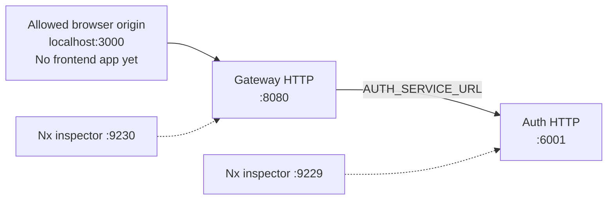

# Configuration reference

[Documentation hub](../README.md) · [Setup](../development/getting-started.md)

**Status:** Inputs read by current source. **Reviewed:** 2026-10-21.

Both application entry points import `dotenv/config`. Use a root `.env` based on
[.env.example](../../.env.example) and run development commands from the root.
Existing process environment variables take precedence. Prisma CLI also loads
dotenv through [prisma.config.ts](../../prisma.config.ts).

## Environment inputs

| Variable             | Consumer                       | Default / behavior                                                                                                |
| -------------------- | ------------------------------ | ----------------------------------------------------------------------------------------------------------------- | --- | ----------------------------------------------- |
| `PORT`               | Each HTTP app                  | Auth `6001`, gateway `8080`; a supplied value passes through `Number()` with no explicit integer/range validation |
| `AUTH_SERVICE_URL`   | Gateway                        | `http://localhost:6001`; all forwarded paths use this one upstream                                                |
| `DATABASE_URL`       | Prisma CLI/client              | MongoDB connection string; root example uses local `eshop`; no application fallback                               |
| `REDIS_DATABASE_URL` | Auth Redis client              | Passed directly to ioredis; root example uses `redis://127.0.0.1:6379`; no application validation                 |
| `SMTP_HOST`          | Auth mail                      | Passed to Nodemailer; root example is a placeholder                                                               |
| `SMTP_SERVICE`       | Auth mail                      | Optional Nodemailer provider setting; read in code but absent from `.env.example`                                 |
| `SMTP_PORT`          | Auth mail                      | `Number(value)                                                                                                    |     | 587`; exact string `'465'` enables implicit TLS |
| `SMTP_USER`          | Auth mail                      | SMTP authentication user and sender address                                                                       |
| `SMTP_PASSWORD`      | Auth mail                      | SMTP authentication secret                                                                                        |
| `NODE_ENV`           | Prisma wrapper / gateway build | Prisma global reuse outside production; gateway source-map configuration checks production                        |
| `HOST`               | E2E setup only                 | Test destination defaults to `localhost`; HTTP apps do not read it as a bind address                              |

The Redis non-null assertion is a TypeScript annotation, not a runtime check.
Supply a TCP `redis://` or `rediss://` URL for the existing client. No central
configuration parser validates missing inputs or waits for dependencies.

## Ports and local topology

Leave `PORT` unset in `.env` and the launching shell when running `npm run dev`.
A shared override reaches both services, causing a port conflict. To use custom
ports, start each app in its own environment and set the gateway's
`AUTH_SERVICE_URL` to the auth address. Inspector ports are separate Nx serve
options, not HTTP destinations.

In the auth Dockerfile `PORT=3000` is configured; `-p 6001:3000` publishes it for a
host-run gateway. The Dockerfile also sets `HOST=0.0.0.0`, but the app does not
read `HOST`. See [deployment](../operations/deployment.md) for container network
and packaging limits.

## Fixed application policy

These settings are currently source constants, not environment variables:

| Setting                                 | Value / owner                                                     |
| --------------------------------------- | ----------------------------------------------------------------- |
| Browser origin                          | `http://localhost:3000`, credentials enabled in both apps         |
| Allowed CORS request headers            | `Authorization`, `Content-Type`                                   |
| Auth JSON / gateway proxy body limit    | 16 KB                                                             |
| Gateway quota                           | 100 requests / 15 minutes, per-process in-memory store            |
| Gateway upstream timeout                | 10,000 ms                                                         |
| SMTP connection/greeting/socket timeout | 10,000 ms each                                                    |
| OTP lifetime / cooldown                 | 300 / 60 seconds                                                  |
| OTP counter / spam-lock expiry          | 3,600 seconds; counter expiry refreshed on each allowed increment |
| Swagger advertised host                 | `localhost:6001` in committed JSON                                |

Sources: [gateway](../../apps/api-gateway/src/main.ts),
[auth](../../apps/auth-service/src/main.ts),
[OTP helpers](../../apps/auth-service/src/utils/auth.helper.ts), and
[mail](../../apps/auth-service/src/mail/mail.client.ts).
Future validation, shared quotas, and ingress decisions are in the
[Redis/runtime plan](../future-plans/architecture/redis-and-runtime-plan.md).
