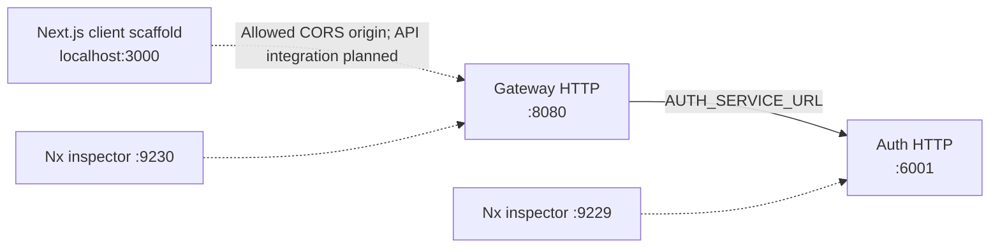

# Configuration reference

[Documentation hub](../README.md) · [Setup](../development/getting-started.md)

**Status:** Inputs read by current source. **Reviewed:** 2026-10-25.

Both backend application entry points import `dotenv/config`. Use a root `.env` based on
[.env.example](../../.env.example) and run development commands from the root.
Existing process environment variables take precedence. Prisma CLI also loads
dotenv through [prisma.config.ts](../../prisma.config.ts).

## Environment inputs

| Variable                   | Consumer                       | Default / behavior                                                                                                |
| -------------------------- | ------------------------------ | ----------------------------------------------------------------------------------------------------------------- |
| `PORT`                     | Each backend HTTP app          | Auth `6001`, gateway `8080`; a supplied value passes through `Number()` with no explicit integer/range validation |
| `AUTH_SERVICE_URL`         | Gateway                        | `http://localhost:6001`; all forwarded paths use this one upstream                                                |
| `DATABASE_URL`             | Prisma CLI/client              | MongoDB connection string; root example uses local `eshop`; no application fallback                               |
| `REDIS_DATABASE_URL`       | Auth Redis client              | Passed directly to ioredis; root example uses `redis://127.0.0.1:6379`; no application validation                 |
| `SMTP_HOST`                | Auth mail                      | Passed to Nodemailer; root example is a placeholder                                                               |
| `SMTP_SERVICE`             | Auth mail                      | Optional Nodemailer provider setting; read in code but absent from `.env.example`                                 |
| `SMTP_PORT`                | Auth mail                      | `Number(value) \|\| 587`; exact string `'465'` enables implicit TLS                                               |
| `SMTP_USER`                | Auth mail                      | SMTP authentication user and sender address                                                                       |
| `SMTP_PASSWORD`            | Auth mail                      | SMTP authentication secret                                                                                        |
| `JWT_ACCESS_TOKEN_SECRET`  | Auth login                     | Signing secret for access JWTs; no fallback; token expires in 15 minutes                                          |
| `JWT_REFRESH_TOKEN_SECRET` | Auth login                     | Signing secret for refresh JWTs; no fallback; token expires in 7 days                                             |
| `NODE_ENV`                 | Prisma wrapper / gateway build | Prisma global reuse outside production; gateway source-map configuration checks production                        |
| `HOST`                     | E2E setup only                 | Test destination defaults to `localhost`; HTTP apps do not read it as a bind address                              |

The Redis non-null assertion is a TypeScript annotation, not a runtime check.
Supply a TCP `redis://` or `rediss://` URL for the existing client. No central
configuration parser validates missing inputs or waits for dependencies.

Set distinct JWT signing secrets in your local `.env` or deployment environment;
the `.env.example` values are placeholders. Login passes the values directly to
`jwt.sign`. Missing secrets are discovered during signing and reach the generic
500 handler, rather than failing startup validation. Keep secret values out of
logs, screenshots, and PR evidence.

## Ports and local topology

Leave `PORT` unset in `.env` and the launching shell when running `npm run dev`.
A shared override reaches both services, causing a port conflict. To use custom
ports, start each app in its own environment and set the gateway's
`AUTH_SERVICE_URL` to the auth address. Inspector ports are separate Nx serve
options, not HTTP destinations.

In the auth Dockerfile `PORT=3000` is configured; `-p 6001:3000` publishes it for a
host-run gateway. The Dockerfile also sets `HOST=0.0.0.0`, but the app does not
read `HOST`. See [deployment](../operations/deployment.md) for container network
and packaging limits.

## Client configuration

The client has no application-defined API URL, auth, locale, or theme environment
variables. `npm run client` starts Next.js development on port 3000 by default.
The framework can accept a different port through its CLI/environment; keep
backend CORS aligned if adding browser API integration. Avoid a shared `PORT`
override when launching the backend and client together.

Client dependencies are installed at the root npm workspace. Its
[Next config](../../apps/client/next.config.js) configures `@svgr/webpack` for SVG
component imports in Turbopack and Webpack, with no rewrites or proxy configuration. [PostCSS](../../apps/client/postcss.config.mjs) loads
`@tailwindcss/postcss`; [global.css](../../apps/client/src/app/global.css) imports
the palette/scales from [packages/ui/theme.css](../../packages/ui/theme.css) and
registers the shared UI source for Tailwind scanning. See [shared UI](shared-ui.md)
for additional consuming apps. `apps/client/index.d.ts` references the shared
SVG component declaration in `packages/assets/svg.d.ts`. Client TypeScript maps
`@packages/*`, includes shared TSX, and references the shared composite project;
its declaration outputs must exist for the standalone no-emit check. See [design tokens](design-tokens.md) for exact utilities and
light/dark selectors. Theme choice is explicit CSS selection, without controls,
system-preference detection, or persistence. Inter is not bundled.

## Fixed backend policy

These settings are currently source constants, not environment variables:

| Setting                                 | Value / owner                                                                       |
| --------------------------------------- | ----------------------------------------------------------------------------------- |
| Browser origin                          | `http://localhost:3000`, credentials enabled in both apps                           |
| Allowed CORS request headers            | `Authorization`, `Content-Type`                                                     |
| Auth JSON / gateway proxy body limit    | 16 KB                                                                               |
| Gateway quota                           | 100 requests / 15 minutes, per-process in-memory store                              |
| Gateway upstream timeout                | 10,000 ms                                                                           |
| SMTP connection/greeting/socket timeout | 10,000 ms each                                                                      |
| OTP lifetime / cooldown                 | 300 / 60 seconds                                                                    |
| OTP counter / spam-lock expiry          | 3,600 seconds; counter expiry refreshed on each allowed increment                   |
| Access / refresh JWT expiry             | 15 minutes / 7 days; payload contains user ID and fixed `role: 'user'`              |
| Auth cookie names                       | `access_token`, `refresh_token`                                                     |
| Both auth cookie policies               | `httpOnly: true`, `secure: true`, `sameSite: 'none'`, 7-day `maxAge` (604800000 ms) |
| Swagger advertised host                 | `localhost:6001` in committed JSON                                                  |

Sources: [gateway](../../apps/api-gateway/src/main.ts),
[auth](../../apps/auth-service/src/main.ts),
[OTP helpers](../../apps/auth-service/src/utils/auth.helper.ts), and
[mail](../../apps/auth-service/src/mail/mail.client.ts),
[login controller](../../apps/auth-service/src/controller/auth.controller.ts), and
[cookie helper](../../apps/auth-service/src/utils/cookies/setCookies.ts).
Cookies are always marked Secure; there is no `NODE_ENV` override. Their retention
and JWT expiry differ for the access token. Refresh, logout, token verification,
CSRF policy, and production browser behavior still need implementation/validation.
Future validation, shared quotas, and ingress decisions are in the
[Redis/runtime plan](../future-plans/architecture/redis-and-runtime-plan.md).
